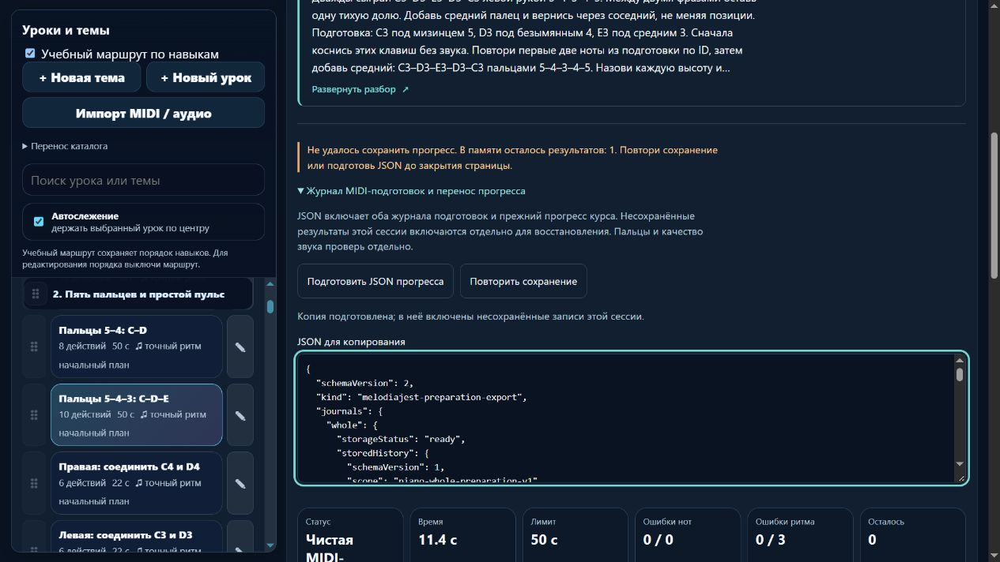

# MelodiaJest — сохранение прогресса между вкладками, 6 ноября 2026, партия 28

В локальном релизе **23.5.28** исправлена воспроизведённая потеря прогресса: вкладка со старым снимком завершала урок и целиком заменяла словарь, уничтожая уже сохранённый результат другой вкладки и личное поле. Новый механизм читает свежие данные под общей блокировкой и записывает одну операцию. Повтор после сбоя обратного чтения не даёт двойного зачёта. **Новых/исправленных музыкальных уроков и планов — 0. Импорт пока не включён.** Это необходимый этап сохранности перед импортом v1/v2.

## Воспроизведение и исправление

До изменений настоящий контроллер приложения загружен с пустой изолированной историей. Затем в хранилище записаны результат правой руки и личное расширение, имитируя другую вкладку/перенос. Завершение левого упражнения старой вкладкой сохранило его результат, но удалило обе прежние записи. `tmp/piano-batch-52-reproduction.json` фиксирует `importedRecordLost: true`, `privateExtensionLost: true`. Пользовательское хранилище не использовалось.

`piano-progress-store.js/.d.ts` сохраняет существующий ключ `music-learning-piano-v1`. Любая новая запись полного прогресса проходит через эксклюзивную Web Lock `melodiajest:piano-progress-v1`, свежий read, проверку целевой строки, исполняемый `PracticeAssessment.record`, write/readback. Остальные уроки, личные поля, дополнительные данные попыток и архивы сохраняются. Старые музыкальные редакции архивируются прежним оценщиком, новый зачёт не наследуется. Прежний оценщик и музыкальные данные не переписывались.

Служебное поле строки `melodiajestPersistence` имеет версию 1 и квитанции операций. Совпавший ID с тем же содержимым не добавляет повтор; конфликт не заменяет исходник. Поздняя операция пересчитывается в хронологическом порядке реальным оценщиком, сохраняя раннюю дату и отсроченную память. Неудачная попытка больше не удаляет двадцатый чистый повтор. Прежняя политика последних 20 попыток остаётся; квитанции не обрезаются молча при пределе 2048 на строку. Общая строка ограничена 2 000 000 символов. Повреждённый/неподдержанный формат, недоступные Web Locks, ошибки чтения/записи и переполнение оставляют явный pending и доступные восстановительные данные.

В UI машинный результат и подтверждение сохранения видны отдельно. При pending счётчик показывает подтверждённую историю, рядом объяснение ошибки, повтор и подготовка JSON. Старый незащищённый `localStorage.setItem` полного словаря заменён. Фрагментная ветка по-прежнему возвращается раньше и не записывает зачёт полного родителя.

## Экспорт и удобство

Пакет экспорта остаётся **v2** `melodiajest-preparation-export`: два MIDI-журнала и точная доступная строка `legacy.raw`. Добавлен необязательный `legacyRecovery` со схемой 1, `pending`, `baseRaw`, `draftRaw`, когда у этой страницы есть несохранённые операции старого счётчика. Живое поколение используется для проверки свежести, но не сохраняется в пакет. Старый программный API v1 и трёхаргументный v2 совместимы.

Операции восстановления старого счётчика не содержат самостоятельного доказательства MIDI: будущий импортёр не должен превращать `clean: true` в новую проверенную подготовку. Истории подготовки продолжают хранить и переоценивать реальные on/off-события. Несколько ключей не являются общей атомарной транзакцией; pending другой вкладки нужно сохранять в ней.

Браузер выявил дополнительную помеху: асинхронный рендер мог закрыть только что раскрытый журнал. Намерение нативного summary теперь фиксируется сразу, события отсоединённого старого DOM не переписывают его. Enter раскрывает журнал; повтор/экспорт остаются доступны. В памяти при сохранённом развёрнутом виде — **0 JSON, 0 учебных карточек, 0 нотных `data-score-step`**. Компактное превью и сохранённая настройка не менялись.

## Проверка в изолированном браузере

Две реальные вкладки одного QA-origin **4212**, открытые до первых результатов, используют нативные Web Locks. Только QA-ключи `melodiajest-qa52:*`; стенд явно подписан как синтетические MIDI/время. Кнопка стенда передаёт сообщения настоящим MIDI-обработчикам приложения; физический инструмент не проверялся. Обычная публичная сборка отдельно проверена на **4211**. Пользовательский origin 4173 не менялся.

1. В первой вкладке запрещена запись прежнего прогресса, сыграна правая `course02-02`. Машинная попытка чистая, сохранённый счётчик **0/3**, pending 1. JSON сохраняет исходное личное поле, draft с результатом и один реальный журнал подготовки.
2. Вторая вкладка сохраняет левую `course03-02`. Разрешение записи и повтор первой дают **правая 1, левая 1**, личное поле и архив прежние.
3. Вторая вкладка со старым собственным снимком играет ещё раз: **правая 1, левая 2**, чужой результат не теряется.
4. После загрузки исправления раскрытия имитирован успешный write и неудачный readback третьей левой попытки. Сохранённая строка имеет 3, подтверждённый UI пока 2 и pending 1. Retry оставляет **левую 3 и ровно 3 квитанции**, правую 1, личное поле прежним; recovery больше не нужен. Журнал остаётся раскрытым.

Обычный экспорт на ширине 390 px: `completeCopy: true`, необязательного recovery нет, документ client/scroll **376/376**, поле JSON **318,4 px**, кнопка **44 px**. Консоли трёх вкладок без ошибок. Собственные вкладки закрыты, viewport сброшен, порты **4211/4212 закрыты**. Снимки [ошибки записи](../qa/piano-2026-11-06-28-recovery.png) и [мобильного экспорта](../qa/piano-2026-11-06-28-mobile.png) сохранены. Нативный диалог beforeunload не подтверждался; обработчик pending проверен исполняемым тестом.

## Регрессии, сборки и сохранность

- `npm test`: **573/573**, 0 ошибок, 237297 мс. Добавлены 13 содержательных проверок свежей записи, двух вкладок, личных расширений/архивов, поздних операций, удержания ранней даты, повторов после readback и настоящего контроллера/экспорта/памяти. Первый полный прогон дал 571/573: два прежних теста читали хранилище до завершения новой асинхронной записи. Они переведены на ожидание настоящего store, целевой прогон 27/27, затем полный 573/573.
- После полного прогона исправлена только привязка раскрытия панели. Финальные **41/41** целевых проверок и свежий браузерный стенд проверены после этого изменения; финальные 13/13 store-регрессий также проходят. Строгий TypeScript с настоящими DOM `Storage`/`LockManager` — exit 0.
- `audit:lessons`: после исправлений противоречий нет. `audit:fingering`: структурных отказов 0, начальные **80 уроков / 1036 назначений** проходят. Остаются **83 неподдержанных действия** и **10 отмеченных уроков**. `audit:curriculum`: `hardErrors: []`. `audit:preparations`: 2 плана, 6 требований, пустые истории pending. Это структурные проверки, не экспертиза преподавателем.
- Все **570 записей каталога, 570 музыкальных MIDI-версий и 6 требований подготовки совпадают** с checkpoint. Экспорт при выбранной пятинотной области также сохраняет 570 записей. Из 58 защищённых файлов **54 прежние**; изменены `index.html`, `package.json`, `piano-preparation-capture.js/.d.ts`. Новые — `piano-progress-store.js/.d.ts`. Изменены allowlist и загрузчик/тестовые фикстуры для исполняемой интеграции. Оценщик, аппликатура, музыка, CSS, звук и `lesson-review-baseline.js` прежние. Содержательные общие/гитарные проверки проходят, гитарный маршрут совпадает, `guitarjest` не изменялся. `trainer-content.json` отсутствовал и не создавался.
- Основная веб-сборка: **25 разрешённых ресурсов**, исходный сервер не публикуется. Необязательный reader **6/6**, Next **4/4** и production build; lint Next остаётся отключённым. Все хеши манифестов сверены, шесть payload-ресурсов reader и 17 Next runtime chunks прежние; базовый релиз 23.5.28. Полный перенос каталога/аккаунтов/MIDI/звука/прогресса в React/Next не заявляется.
- Локальный `server.cjs` без установки зависимостей отдал точные пять новых/смежных модулей на временном loopback-порту; `/api/content` и native endpoint не вызывались. `git diff --check` — exit 0, без заявления о чистоте checkout.

Учёт прежний: **422 учебных записи, 158 MIDI-маршрута, 82 с подробным происхождением/сопоставлением, 6 будущих планов, 0 независимых преподавательских проверок**. Шесть вариантов одной цели и один checkpoint учтены отдельно; **415 — верхняя граница**, не подтверждённое число самостоятельных задач. Матрица на 1310 мест не является тысячей готовых/проверенных уроков. Банк новых первых проб по-прежнему имеет 0 элементов, шесть планов не продвинуты.

## Источники и продолжение

Перечитаны первичные [WHATWG Web Storage, 12.1 и 12.2.3](https://html.spec.whatwg.org/multipage/webstorage.html): нельзя предполагать автоматическую блокировку read/modify/write; доступ/запись могут отказать. [W3C Web Locks, Abstract/Introduction](https://www.w3.org/TR/web-locks/) обосновывает согласование эксклюзивного ресурса между участвующими задачами origin. Наши receipts, размеры, число повторов и музыкальный зачёт — решения проекта.

find-skills использован через [skills.sh](https://skills.sh/), переиспользованы проверенные первичные навыки. Прочитаны Vercel `client-localstorage-schema` и свежие [Web Interface Guidelines](https://raw.githubusercontent.com/vercel-labs/web-interface-guidelines/main/command.md): версии и ошибки хранения, доступная обратная связь/повтор, клавиатура/фокус и размер действий. Пример удаления старого ключа не применён. Новый React-экран, измеренное ускорение, установки навыков/плагинов/библиотек не заявляются. Журнал источников сохранил 43 ID, добавлены применения/перечтения трёх технических записей. Новых музыкальных атрибуций нет.

**Ограничение:** Web Locks согласуют только использующих протокол участников одного origin. Вкладки со старым загруженным кодом нужно перезагрузить после обновления; прямые сторонние записи не защищены. Подтверждение сохранения не удостоверяет исполнителя, устройство, пальцы или художественное качество.

**Следующий точный шаг:** валидатор и предварительный результат импорта v2/v1 без записи, затем перенос с сохранением исходного пакета и отказом молча заменять отличающиеся данные. Будущий импортёр должен использовать `PianoProgressStore.LOCK_NAME` и блокировки двух журналов в постоянном порядке, проверить receipts/архивы/recovery, выдержать частичный сбой с идемпотентным повтором. Recovery старого счётчика не повышает статус MIDI. После этого — допуск чтения и неопубликованный посильный банк, затем дальнейшие небольшие учебные партии.

Домен не покупался, DNS/портал/хостинг/секреты не менялись, публикации/commit/push не было. Квота проверялась штатно до тяжёлых этапов и завершения: резерв 0%, последний недельный остаток 42%, обычное использование разрешено. Это общая квота аккаунта, не индивидуальный бюджет или аппаратное отсечение.

Доказательства: [машинная сводка](piano-curriculum-2026-11-06-28-verification.json), [контракт](../PIANO_PREPARATION_CONTRACT.md); `tmp/piano-batch-52-before.json`, `reproduction.json`, `preservation.json`, `browser.json`, `pending-export.json`, `stale-export.json`, `readback-export.json`, `saved-export.json` с тем же префиксом; журналы `tmp/piano-batch-52-{tests-final,focused-final,progress-final,types-final,lessons,fingering,curriculum,preparations,coverage,reader,next,build-web-final}.log`; `tmp/piano-batch-52-local-server.json`.
Примечание из партии 29: вложенная объектная часть `tmp/piano-batch-52-saved-export.json`, извлечённая браузерным инструментом, содержит маркеры ограничения глубины `[MaxDepth]`. Она не является побайтовой копией поля JSON. Вложенные строковые `storedHistoryRaw`/`legacy.raw` сохранены и позволили повторно получить корректный пакет через настоящий API без записи; прежний снимок оставлен отрицательным примером. Проверки старого прогресса в партии 28 использовали `legacy.raw` и остаются действующими. [Подробности](piano-curriculum-2026-11-06-29.md).

