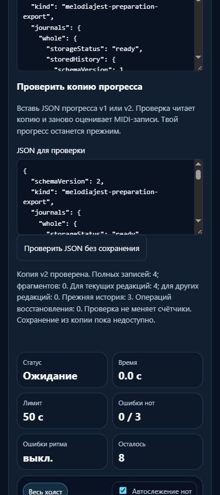

# MelodiaJest — проверка копий прогресса перед переносом, 6 ноября 2026, партия 29

Локальный релиз **23.5.29** добавляет работающий предпросмотр копий v1/v2: в журнале есть поле «JSON для проверки» и кнопка «Проверить JSON без сохранения». Проверка заново оценивает MIDI-записи и показывает состав копии, текущие/другие редакции, недоступные журналы и recovery. **Счётчики не меняются, записи импорта ещё нет. Новых уроков и планов — 0.** Это законченный этап проверки исходного пакета перед сравнением с данными назначения и сохранением.

## Проверяемое поведение

`piano-preparation-transfer.js/.d.ts` работает без зависимостей от хранилища, сети, DOM и собственных часов. Получает строку, настоящий гидратированный каталог и UTC-время. `canWrite` всегда false. Текущие шесть требований получены теми же compile/профилями приложения; нет отдельной копии музыкального оценщика.

Для v1 явно существуют whole и legacy; отсутствующий fragment не трактуется как пустая история назначения. В v2 требуются оба журнала. Доступный raw проверяется настоящим scoped store и `PianoPreparation.assessAttempt`, а объектный снимок должен ему соответствовать. Порядок полей и пробелы допустимы, различие содержимого отклоняется. Чужая область, потерянное отпускание, неверная высота, помощь, будущая дата или неизвестная версия не становятся успешной подготовкой. Правильные старые редакции остаются архивами, без текущего зачёта.

Совпавшие копии не увеличивают число наблюдений. Конфликт одного ID с разными данными отклоняет пакет. Прежний `evaluate` также распознаёт одинаковое исполнение с новыми ID/датами. Старый прогресс проверяет read-only `PianoProgressStore.inspect`, переиспользующий живые правила строк, архивов и receipts. Личные непродвигаемые записи сохраняются в исходном пакете. Legacy recovery структурно проверяется, **не исполняется и не превращается в новое MIDI-доказательство**.

Недоступный журнал или больше 512 уникальных записей отмечают копию неполной; архив не обрезается. До интерпретации JSON выявляются повторяющиеся имена, в том числе равные после Unicode escape. Пакет ограничен 32 000 000 символов, 64 уровнями, 2 000 000 узлов/имён; recovery журнала — 4096 записей. Не конечные числа и небезопасные целые отклоняются. HTML maxlength не используется: превышение размера не укорачивает вставленный текст молча. Все ограничения — решения проекта, не размеры из RFC.

Подписанное поле принимает paste. Ошибка остаётся рядом, выставляет aria-invalid и сохраняет ввод; результат получает фокус и объявляется polite status. При редактировании прежний результат очищается без пересоздания поля. В памяти и во время активной проверки поля/результаты JSON отсутствуют в DOM независимо от сохранённого вида материалов. CSS, компактный ленивый разбор и сохраняемая настройка прежние.

## Найденное рассогласование тестового снимка

Предпросмотр отклонил `tmp/piano-batch-52-saved-export.json`: в объектной части старого снимка браузерный инструмент сократил глубокие массивы до `[MaxDepth]`. Строковый `storedHistoryRaw` содержит полные исходные события и не совпадает с этим сокращённым объектом. Это ограничение извлечённого QA-снимка, не повреждение данных приложением. Исходный файл оставлен отрицательным примером; отчёт партии 28 дополнен точным примечанием. Его проверки прежнего прогресса использовали строковый `legacy.raw` и не зависят от сокращённых вложенных массивов.

`tmp/piano-batch-53-roundtrip.cjs` подал сохранённые raw-строки в изолированное хранилище и повторно вызвал настоящий API `exportCombined`. Ни одной записи не было, исходный файл не изменён, raw-строки сохранены. Получен корректный `tmp/piano-batch-53-validated-fixture.json` с четырьмя MIDI-попытками. Проверка не была ослаблена ради принятия прежнего несогласованного снимка. Новые большие JSON из DOM читаются строкой, затем разбираются вне браузерной сериализации.

## Проверки

- `npm test`: **589/589**, 0 ошибок, 231019 мс. Добавлены **16** регрессий реальных API v1/v2, областей/оценщика, raw-согласованности, архивов/receipts, конфликтов ID, одинаковых исполнений, recovery без зачёта, неполных/слишком больших копий, имён JSON, чисел и actual UI без записи. После полного прогона публичный guard `isOperation` уточнён до строгого boolean; прежние условия истинности не менялись. Финальные **57/57** целевых проверок и веб-сборка прошли после этого уточнения. Строгий TypeScript с прежним DOM-контрактом и новым read-only union — exit 0.
- `audit:lessons`: после исправлений противоречий нет. `audit:fingering`: структурных отказов 0; **80 начальных уроков / 1036 назначений** проходят. Остаются **83 неподдержанных действия, 10 отмеченных уроков**. `audit:curriculum`: `hardErrors: []`. `audit:preparations`: два плана, шесть требований, пустые состояния pending. Это не педагогическая экспертиза.
- Все **570 записей каталога, 570 музыкальных версий и 6 требований подготовки прежние**. Экспорт при активном пятинотном фрагменте сохраняет весь каталог. Из 60 защищённых файлов 56 прежние; изменены `index.html`, `package.json`, `piano-progress-store.js/.d.ts`. Новые — transfer и его типы. Изменены allowlist/загрузчик тестов. Оценщик, ноты, ритм, руки/пальцы, аудио, CSS, миграции и `lesson-review-baseline.js` прежние. Гитарные/общие содержательные тесты проходят, маршрут совпадает, `guitarjest` не изменялся. `trainer-content.json` отсутствовал и не создавался.
- Основная публичная сборка содержит **26 разрешённых ресурсов**. Reader **6/6**, Next **4/4** и production build, lint Next отключён. Использован уже установленный toolchain портала через явный `--dependencies-dir`, без установки. Next потребовал разрешённое чтение метаданных пути пользователя за границей обычной песочницы; исходники/результаты записывались в pianosjest. Все манифесты и хеши сверены, шесть reader payload-файлов и 17 Next runtime chunks прежние, базовый релиз 23.5.29. Полная миграция сервиса на React/Next не заявляется.
- Локальный dependency-free `server.cjs` отдал шесть точных модулей на временном loopback-порту. Content API и Windows endpoint не вызывались. `git diff --check` — exit 0, без утверждения о чистоте checkout.

## Реальный браузер

Обычная сборка проверена на изолированном origin **4213**. Входная копия получена повторным экспортом сохранённых строк QA с синтетическими MIDI/временем из партии 28; новые попытки не исполнялись, физическое устройство не проверялось.

Enter раскрывает журнал, Enter/пробел запускают проверку. Некорректный сокращённый снимок получил понятную ошибку raw-согласованности; корректный v2 показал **4 полных записи, 0 фрагментов, 3 строки прежней истории**. Проверка v1 явно показывает отсутствие fragment. Повторяющееся имя отклонено с aria-invalid, исходный текст сохранился. Изменение ввода убрало устаревший результат. Фокус после проверки — `preparation-inspection-result`.

До и после предпросмотров получен **побайтово одинаковый местный экспорт**, журналы устройства остались пустыми. В памяти при сохранённом развёрнутом виде — 0 полей/результатов JSON и 0 нотных `data-score-step`. При 390 px client/scroll **376/376**, поле **318,4 px**, кнопка **44 px**. Консоль без ошибок. Свои вкладка и порт 4213 закрыты, viewport сброшен; обычный origin 4173 не менялся. [Снимок отказа](../qa/piano-2026-11-06-29-invalid.png) сохранён отдельно.

## Учёт, источники и следующий этап

Учёт прежний: **422 учебных записи, 158 текущего MIDI-маршрута, 82 с подробным происхождением/сопоставлением, 6 будущих планов, 0 независимых преподавательских проверок**. Шесть вариантов одной цели и один checkpoint выделены отдельно; 415 остаётся верхней границей, не проверенным числом самостоятельных задач. Матрица на 1310 мест не является тысячей готовых уроков. Новых первых проб в банке — 0, шесть планов не продвинуты.

Прочитан [RFC 8259, §§4, 6, 8.3, 9](https://www.rfc-editor.org/rfc/rfc8259): различия обработки повторных имён, сравнение декодированных имён и допускаемые ограничения парсера. Строгий отказ и точные пределы — наш выбор. Перечитаны [WHATWG Web Storage](https://html.spec.whatwg.org/multipage/webstorage.html) и [W3C Web Locks](https://www.w3.org/TR/web-locks/) для границы чистого предпросмотра и будущей согласованной записи; общей атомарности нескольких ключей они не создают.

find-skills использован через [skills.sh](https://skills.sh/) и проверенные первичные репозитории. Перечитаны Vercel `client-localstorage-schema` и свежие [Web Interface Guidelines](https://raw.githubusercontent.com/vercel-labs/web-interface-guidelines/main/command.md): сохранение исходника, версии, подписи, paste, статус/фокус и клавиатура. Переиспользовано прежнее оформление. Навыки, библиотеки и плагины не устанавливались; новый React-экран и измеренное ускорение не заявляются. В журнале 44 ID источников: добавлен RFC и применения трёх технических записей. Новых музыкальных/исторических атрибуций нет.

**Следующий точный шаг:** предварительное сравнение с историей назначения, затем безопасная запись. Повторно проверять оригинал под общей legacy-блокировкой и блокировками whole/fragment в постоянном порядке. Сохранить исходный пакет/строки назначения; отличающиеся местные данные не заменять молча. Обработать частичный сбой с идемпотентным повтором, не захватывать ту же блокировку повторно через публичные store-методы. В v1 отсутствующий fragment не трогать, legacy recovery сохранять отдельно от нового MIDI-зачёта. После этого — допуск чтения/неопубликованный банк и дальнейшие небольшие музыкальные партии.

Физический инструмент, пальцы, художественное качество и независимая проверка преподавателем остаются неподтверждёнными. Домен не покупался, DNS/портал/хостинг/секреты не менялись; публикации/commit/push не было. Штатная квота проверялась в начале, перед тяжёлыми частями и завершением: резерв 0%, последний недельный остаток **41%**, обычное использование разрешено. Это общая квота аккаунта, не индивидуальный бюджет и не аппаратное отсечение.

Доказательства: [машинная сводка](piano-curriculum-2026-11-06-29-verification.json), [контракт](../PIANO_PREPARATION_CONTRACT.md); `tmp/piano-batch-53-{before,catalog-before,preservation,browser,roundtrip,validated-fixture,local-server,quota}.json`; `tmp/piano-batch-53-{tests,focused-final,types,lessons,fingering,curriculum,preparations,coverage,reader-final,next-verified,build-web-final}.log`.
