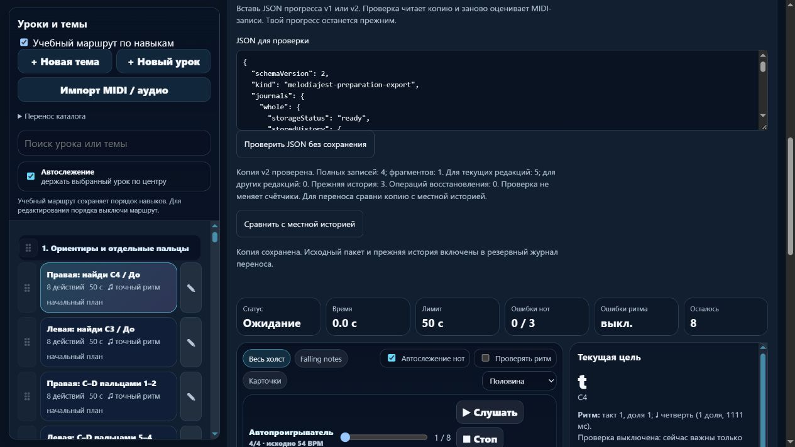

# MelodiaJest — восстановимый перенос прогресса, 6 ноября 2026, партия 30

В локальном релизе **23.5.30** работают сравнение назначения и явное сохранение копий v1/v2. Подготовки и прежний прогресс переносятся в пустую либо совпадающую историю. Отличающаяся непустая история блокирует запись. Перед данными сохраняется резерв с точным исходным пакетом и строками before/after; после частичного сбоя можно продолжить без двойного зачёта. **Новых/исправленных музыкальных уроков и планов — 0.** Следующая партия возвращается к переходу от трёх к пяти пальцам левой руки.

## Сравнение, запись, восстановление

`piano-preparation-import.js/.d.ts` использует настоящий валидатор/оценщик, текущий каталог и три прежние именованные Web Locks в постоянном порядке: legacy → whole → fragment. Создание и preview не пишут данные. Сохранение требует ticket этого экземпляра, повторно проверяет исходник и свежие строки под блокировками. Редактирование отменяет preview. Во время активной попытки/неподтверждённого сохранения результата перенос недоступен. Внутри не вызываются публичные read/append, которые повторно захватили бы те же блокировки.

Пустая входящая история сохраняет местную; семантически совпадающая — её точное форматирование. V1 не читает/не пишет отсутствующий fragment. Отличия непустых историй не объединяются и не заменяются молча. Проверенные MIDI recovery добавляются в свой журнал без повторного ID. Legacy recovery остаётся точным исходным пакетом в резерве, без воспроизведения clean-флагов в новый MIDI-зачёт.

Отдельный ключ `music-preparation-transfer-backups-piano-v1` хранит версию 1, ID/даты операций, sourceRaw, точные before/after и prepared/applied. Резерв записывается и подтверждается обратным чтением до первого изменения данных. Каждый ключ тоже требует readback. Только после этого подтверждается applied. Несколько localStorage-ключей не являются общей атомарной транзакцией.

Повтор принимает только строки, равные before либо after, и пропускает уже записанную часть. Если после сбоя появился другой результат, перенос останавливается; автоматический откат его не стирает. Новая вкладка может взять сохранённый исходный пакет, сравнить и продолжить. Уже applied-пакет не откатывает поздние результаты. Последующий экспорт v2 включает точный `transferArchive`; повреждённая доступная строка также сохраняется для разбора с отметкой unavailable.

Архивы разрешённых пакетов проверяются повторно, включая вложенные источники и соответствие before/after. Пределы проекта: 8 операций без обрезания, 8 уровней вложенных архивов, 128 уникально проверяемых записей и 32 000 000 символов резервной строки. Местная квота может отказать раньше. Ошибка первого резерва не разрешает писать данные.

Новый `archivePending` отдельно распознаёт экспорт посреди незавершённого переноса. Даже при читаемых снимках и completeCopy=true такая копия **incomplete**, её запись в другое назначение заблокирована. Нужно завершить перенос на исходном адресе и получить новый JSON. Местное продолжение prepared-операции работает. Автоматическое разрешение различающихся историй, чужого pending-архива и принудительное повторное восстановление applied-пакета остаются отдельными задачами.

## Интерфейс и браузер

После «Проверить JSON без сохранения» доступны отдельные сравнение и сохранение. Ожидание делает поле readonly и блокирует кнопки, результат получает фокус и polite status. Ошибка сохраняет ввод, предлагает повтор/возврат исходной копии. Редактирование отменяет ticket без пересоздания поля. Pending учитывается в beforeunload; нативный диалог закрытия не подтверждался. В памяти поля/результаты и кнопки переноса отсутствуют независимо от сохранённого вида материалов. CSS, компактное превью и ленивый разбор прежние.

Обычная сборка проверена на **4214**, стенд сбоя — **4215** с явной подписью и отдельным `qa54`-префиксом. Входной файл создан настоящими API из прежних сохранённых QA-строк и одной синтетической фрагментной попытки. **Физического MIDI/новых исполнительских проб не было.** Пользовательский origin 4173 не менялся.

- Две вкладки сравнили одну копию с пустой историей. Первая сохранила **4 whole, 1 fragment и 3 строки legacy**; вторая распознала applied и не удвоила записи. Экспорт содержит ровно один резерв, точный sourceRaw и прежнюю legacy.raw; правый старый счётчик 1, левый 3.
- Отличающаяся непустая копия отклонена. Экспорт назначения до/после отказа побайтово совпал.
- Искусственный сбой после whole оставил **4 whole, 0 fragment, legacy=null**, prepared-резерв с точным исходником и пустыми before. Новая вкладка взяла его исходный пакет и завершила **4/1/legacy** с тем же ID операции и одним резервом. Повтор старой вкладки распознал applied.
- V1 поверх совпадающих данных сохранил существующий fragment=1 и все активные счётчики. Новый резерв относится к другому пакету v1; активные попытки не добавлялись.
- При памяти в развёрнутом виде — 0 полей/кнопок/результатов переноса и 0 нотных data-score-step. На 390 px client/scroll **376/376**, поле **318,4 px**, кнопка **44 px**. Консоли без ошибок.
- Финальный браузер с обновлённым кодом явно показал неполный pending-пакет: сравнение disabled, кнопки записи нет, исходный ввод сохранён, экспорт назначения прежний. Исправлена подсказка, чтобы она не предлагала недоступное сравнение.

Сохранены [частичный сбой](../qa/piano-2026-11-06-30-partial.png), [мобильный результат](../qa/piano-2026-11-06-30-mobile.png), [неполная копия](../qa/piano-2026-11-06-30-incomplete.png). Свои вкладки/порты 4214–4215 закрыты, viewport сброшен. Это реальные браузерные пути с тестовыми данными, не аппаратная/преподавательская проверка.

## Проверки и сохранность

- Финальный `npm test`: **611/611**, 0 ошибок/отмен, 257459 мс. Добавлены **22** регрессии сравнения, всех точек записи/readback, свежего экземпляра после сбоя, двух писателей, позднего результата без отката, архивов/версий/ID, пределов, v1, recovery и actual UI. Первые 609 также прошли; дополнительный полный прогон выполнен после нового отказа portable pending, а не как повтор без изменений.
- Финальные **79/79** целевых проверок, строгий TypeScript с настоящими Storage/LockManager — exit 0. После полного прогона уточнён только текст инструкции для неполной копии; затем целевые проверки, новая сборка и свежий браузер прошли. Старая фикстура одного набора использовала общую очередь для всех имён блокировок и отменила 2 проверки; она исправлена на независимые очереди ресурсов, как у Web Locks. Проверки не ослаблялись.
- `audit:lessons`: после исправлений противоречий нет. `audit:fingering`: структурных отказов 0, **80 начальных уроков / 1036 назначений** проходят; остаются **83 неподдержанных действия и 10 отмеченных уроков**. `audit:curriculum`: hardErrors=[], `audit:preparations`: 2 плана / 6 требований, пустые состояния pending. Поздние изменения касались переноса/подсказки; все музыкальные версии и требования остались теми же. Это структурные проверки, не экспертиза музыкантом.
- **570 записей каталога, 570 музыкальных версий и 6 требований прежние**. Экспорт при активном фрагменте сохраняет весь каталог. Из 62 защищённых файлов 57 прежние; изменены index.html, package.json, transfer.js/.d.ts и capture.d.ts. Новые — import.js/.d.ts. Изменены allowlist/загрузчик/тестовые фикстуры; ноты, ритмы, аппликатура, оценщик, звук, порядок/классификация, CSS и lesson-review-baseline.js не переписывались. Гитарный маршрут совпадает, содержательные общие тесты проходят, guitarjest не изменялся. Trainer-content.json отсутствовал и не создавался.
- Публичная сборка — **27 разрешённых ресурсов**, все хеши сверены. Reader **6/6**, Next **4/4** и production build; lint Next отключён. Их базовый релиз 23.5.30, шесть reader payload-ресурсов и 17 Next runtime chunks прежние. Использован существующий toolchain портала через --dependencies-dir, без установки; разрешено необходимое чтение метаданных пути пользователя. Полная миграция сервиса в React/Next не заявляется.
- Локальный dependency-free сервер отдал **7 точных модулей** на временном loopback-порту. Content API и Windows endpoint не вызывались. Git diff --check — exit 0, без утверждения о чистоте checkout.

Учёт прежний: **422 учебных записи, 158 текущего MIDI-маршрута, 82 с подробным происхождением/сопоставлением, 6 будущих планов, 0 независимых преподавательских проверок**. Шесть повторений одной цели и один checkpoint выделены; **415 — верхняя граница**, не проверенное число разных задач. Матрица на 1310 мест не является тысячей готовых уроков. Банк новых первых проб — 0, планы не продвинуты.

## Источники и продолжение

Перечитаны [WHATWG Web Storage](https://html.spec.whatwg.org/multipage/webstorage.html), разделы 12.1/12.2.3, и [W3C Web Locks](https://www.w3.org/TR/web-locks/), Abstract/Introduction. Они описывают хранение/ошибки и согласование именованного ресурса; наш журнал, порядок трёх блокировок, пределы и стратегия повтора — решения проекта. Защита требует согласованных участников одного origin; прямой сторонний писатель или старый загруженный код не получает её автоматически.

find-skills применён через [skills.sh](https://skills.sh/) и существующие первичные навыки. Свежие [Vercel Web Interface Guidelines](https://raw.githubusercontent.com/vercel-labs/web-interface-guidelines/main/command.md) использованы для явного действия записи, ожидания, ошибок/повтора, фокуса, клавиатуры и мобильного вида. Versioned storage сохраняет прежние ключи и точные строки. Навыки, плагины и библиотеки не устанавливались; нового React-экрана и измеренного ускорения нет. В журнале остаётся 44 ID источников, добавлены применения трёх технических записей. Новых музыкальных/исторических атрибуций нет.

**Следующий точный шаг:** проверить `course03-03` и `course03-04`, их переход к `course03-05` после `course03-02`. Прочитать первичные нотные/методические материалы для левой позиции 5–4–3–2–1 вверх и 1–2–3–4–5 вниз, проверить ритм/паузы и подготовку указательного/большого. Сначала найти существующий мостик своей руки; при подтверждённом отсутствии добавить один короткий. Завершить 1–3 новых/исправленных микроурока с переносом на новую фразу, сохранить ID и пользовательский порядок. Допуск чтения, неопубликованный банк и объединение конфликтующих историй остаются отдельной очередью.

Домен не покупался, DNS/портал/хостинг/секреты не менялись; публикации/commit/push не было. Квота проверялась штатно в начале и перед тяжёлыми частями; резерв 0%, последний недельный остаток **40%**, обычное использование разрешено. Это общая квота, не индивидуальный бюджет и не аппаратное отсечение.

Доказательства: [машинная сводка](piano-curriculum-2026-11-06-30-verification.json), [контракт](../PIANO_PREPARATION_CONTRACT.md); `tmp/piano-batch-54-{before,catalog-before,preservation,browser,valid-fixture,normal-export,partial-export,recovered-export,local-server,quota}.json`; `tmp/piano-batch-54-{tests-final,final-focused,types-final,lessons,fingering,curriculum,preparations,coverage,reader,next,final-build}.log`.
