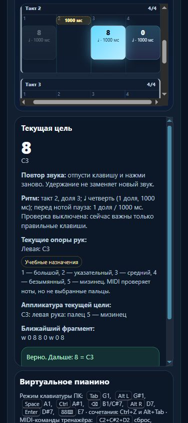

# Партия 33: пропуски в левой позиции и контроль знакомых движений

6 ноября 2026 года, версия **23.5.33**. Уточнены **2 существующих урока**, новых уроков и планов — **0**. Исправлено согласование длительности паузы в текущей цели. Все **571** музыкальная версия, ноты, ритм, пальцы, ID, темы и исходный порядок сохранены. Домен, публикация, S3, commit/push не выполнялись; папка `guitarjest` не менялась.

## Музыкальная проверка и изменения

### `course03-07` — «Скачки C–E–G»

Задача — переход через соседнюю клавишу в одной подготовленной позиции C3–G3. В исходной общей карточке не было отдельного разбора C3–E3 и E3–G3, точного места паузы и применения в другом порядке. Теперь перед соединением разбираются C3–E3–C3 пальцами **5–3–5** и E3–G3–E3 пальцами **3–1–3**. D3 и F3 не звучат; большой находится у G3 без подкладывания. Обычный профиль артикуляции сохранён. Существующие `detail-p-position-skips-03/05` вводят legato и имеют соответствующие требования; они не сделаны обязательными для этой общей задачи.

- Полный MIDI-ряд: **48–52–55–52–48–48–52–55–52–48**; C3–E3–G3–E3–C3 дважды.
- Левая **5–3–1–3–5–5–3–1–3–5**; все длительности — одна доля, **60 BPM**.
- Начала **0–4** и **6–10**. Первый C3 заканчивается у **5**, тишина длится до **6**, затем новый C3. Последнее отпускание у **11**, конечная пауза не задана. Счёт 4/4 продолжается через пятизвучные группы.
- Звуки C–E–G принадлежат до-мажорному трезвучию, но здесь играются последовательно. Карточка не требует одновременного аккорда, полной гаммы или октавного арпеджио.
- Подготовка: `course03-06`, `course03-05`, `detail-p-left-upper-position-01`. Маршрут проверяет все требования до урока.
- Перенос: **E3–G3–E3–C3–E3**, пальцы **3–1–3–5–3**, по одной доле. Другой старт и порядок знакомых переходов — открытая проба применения, не отдельный урок или неизвестный слуховой тест.
- Музыкальная версия **`0e9ed8a3`**, исходный отпечаток инструкции **`bdfceb20`**.

### `course03-08` — «Мини-экзамен левой руки»

Это соединение уже подготовленных движений. Установлен **`learning.goalCounting='checkpoint-only'`**: карточка явно показывает «Контроль знакомых навыков» и исключается из верхней оценки самостоятельных целей. Первоначальное общее «без подсматривания» заменено последовательностью: разбор с подсказками → соединение → отдельная подготовленная попытка памяти.

1. C3–D3–E3–F3–G3–F3–E3–D3–C3, пальцы **5–4–3–2–1–2–3–4–5**, начала **0–8**, окончание у **9**.
2. Тишина **9–10**; C3–E3–G3–E3–C3, пальцы **5–3–1–3–5**, начала **10–14**, окончание у **15**.
3. Тишина **15–16**; F3–G3–F3–G3, пальцы **2–1–2–1**, начала **16–19**, окончание у **20**.

Полные MIDI-высоты: **48–50–52–53–55–53–52–50–48–48–52–55–52–48–53–55–53–55**. Все звуки — четверти при **64 BPM**, две паузы — по одной доле. Итого **20 долей / пять тактов 4/4**; заканчивается на G3, дополнительный C3 не добавлен. Перед заключительной парой отдельно подготовлен переход C3 к F3 через тишину без промежуточных звуков.

Требования: `course03-07`, `course03-06`, `course03-05`, `detail-p-left-upper-position-01`. Проба переноса меняет порядок трёх известных частей, сохраняя их пальцы и долю тишины между ними. Музыкальная версия **`23150801`**, исходный отпечаток инструкции **`59f96a75`**.

Следующий именованный шаг — уже подготовленный `detail-p-left-triple-pulse-01`, расположенный после контроля. Требования следующего урока, включая отпускание левой руки, находятся перед ним. На финальной сверке исправлена первоначально выбранная ссылка к раннему `course04-01`; добавлена регрессия перехода вперёд и порядка всех его требований.

Обе инструкции сохраняют происхождение «техническое упражнение проекта», медленный разбор, счёт, слуховое представление, типичные ошибки, самопроверку, блок **3–5 минут**, возврат после перерыва и память на следующий день. Оценка MIDI не подтверждает пальцы, комфорт руки и художественное качество.

## Защита редакций и малое улучшение интерфейса

`reviewLeftSkipsAndCheckpoint` изменяет только совпавшие исходные инструкции и архивирует их. Личные название, описание, требования, роль, музыкальные правки, собственный review и классификация `piece` защищены. Повторный запуск идемпотентен; `lesson-review-baseline.js` не пересоздавался.

Подтверждённая проблема `rhythm-rest-label-plural` воспроизведена до правки: «перед нотой пауза 1 доли / 1000 мс». Текущая цель теперь использует существующий чистый `rhythmDurationView`: **1 доля, 2 доли, 5 долей, 0,5 доли**. Для нечислового/неограниченного значения долей, когда известно исходное время тишины, не печатаются Infinity/NaN или выдуманные доли: остаётся доступное время в миллисекундах. Нормализация ритма, оценщик, звук и время нот не изменены. Подсказки памяти по-прежнему отсутствуют.

## Первичные источники

Прочитаны **06.11.2026**, два ID и применение партии добавлены в `docs/piano-curriculum-sources.json`:

- **The Open University / OpenLearn**, *An introduction to music theory*, **§7, Example 63 и абзацы после него**: C–E–G и две терции, большая снизу и малая сверху. Это проверка звукового состава, не источник наших пальцев или фразы. [Раздел](https://www.open.edu/openlearn/history-the-arts/music/an-introduction-music-theory/content-section-7).
- **Jerry Kovarsky**, Yamaha, *The Basics Of Piano Keyboard Fingering*, 28.11.2023, **The Basics / Scenario One**: номера пальцев и подготовленный выбор одной позиции. [Авторская статья](https://hub.yamaha.com/keyboards/k-how-to/the-basics-of-piano-keyboard-fingering/).
- **Carl Czerny**, *Briefe über den Unterricht auf dem Pianoforte*, **Dritter Brief, исходные страницы 20–21**: различие удержания и паузы, своевременное отпускание. Прочитана цифровая транскрипция KölnKlavier, не факсимиле; издание Wien: A. Diabelli und Comp., дата в транскрибированном титуле отсутствует. [Текст](https://www.koelnklavier.de/quellen/czer-brf/brief-03.html).
- **Bob Duke и Amy Simmons**, University of Texas, *Tips for Effective Practice*: небольшая цель, посильная часть, слуховой образ, другой старт и распределённая практика. [Авторский материал](https://cml.music.utexas.edu/online-resources/intelligent-music-practice/10-tips-for-effective-practice).

Конкретные рисунки, темпы, пальцы, длительности, перенос и MIDI-допуски принадлежат проекту. Они не названы упражнениями этих авторов, преподавательски утверждёнными уроками или свидетельством обучения знаменитых исполнителей.

## Проверки

- **`npm test`: 635/635**, отказов/отмен **0**, **319895 мс**. Добавлены восемь регрессий: независимые музыкальные ожидания, подготовка, точная миграция, личные правки, учёт контроля, реальные функции оценщика/представления, сохранение каталога и прогресса.
- Целевые **42/42**; после расширения связанной подготовки — дополнительные **38/38**. Первый полный прогон обнаружил четыре устаревших ожидания: две фиксированные короткие цепочки предков, один список контрольных карточек и старую подпись паузы с точкой. Ожидания исправлены; сохранены проверки времени, пальцев, отсутствия циклов, исходного порядка и принадлежности руки.
- `audit:lessons`: после исправлений **0 замечаний**, 423 пианистические и 456 гитарных учебных записей проверены без записи в `guitarjest`.
- `audit:fingering`: **0 структурных отказов**, начальный корпус **80 уроков / 1036 назначений** корректен. Сохраняются **83 неподдерживаемых действия / 10 помеченных уроков**; это не физическая экспертиза.
- `audit:curriculum`: **hardErrors=[]**, 571 пианистическая и 713 гитарных записей. Все **713** записей гитарного маршрута содержательно совпадают с HEAD; пользовательские темы и порядок не переписаны.
- Все **571** музыкальные версии и поля pattern/rhythm/fingeringSpec/themeId/order совпали с отдельным снимком до партии после одинаковой JSON-нормализации отсутствующих полей.
- `build:web`: **27** разрешённых ресурсов в `dist/web`, версия **23.5.33**. Дополнительные React/Next-пакеты не менялись; их последний отдельно проверенный базовый выпуск — **23.5.30**.

### Изолированный браузер

Проверен настоящий `dist/web` на **http://127.0.0.1:4217**, новая вкладка **82**, ширина **390×844**. Разбор скачков раскрыт Enter и свёрнут пробелом; полный текст присутствует при раскрытии. Превью **112 px / 22,4 px = 5 строк**, ширина документа **376 ≤ 390 px**. Переход к `course03-06` клавишей Enter передаёт фокус заголовку подготовки. Мини-экзамен открыт клавиатурой и явно показывает роль контроля.

Через виртуальные клавиши сыграны первые C3–E3–G3–E3–C3; следующая цель показала **«перед нотой пауза: 1 доля / 1000 мс»**. Проверка ритма была выключена, звук и настоящее MIDI-устройство не подключались; это проверка интерфейса, не зачёт исполнения.

В памяти нет кнопки разбора, подсказки повтора и текста цели; выбор вида заблокирован. «Скрыто» пережило reload, доступный селектор вернул «Кратко»; полный разбор в компактном DOM не строился. Кратковременная задержка управления браузером устранена восстановлением той же вкладки, сохранение скрытого вида проверено после восстановления. Вкладка 82 закрыта, ширина восстановлена, собственный preview остановлен; пользовательская вкладка **4173** сохранена.

## Учёт и следующий шаг

| Статус | Количество |
| --- | ---: |
| Реализованные учебные записи пианино | 423 |
| Текущий маршрут с машинной проверкой MIDI | 159 |
| Подробное происхождение и проверенная редакция объяснений | 89 |
| Отдельные будущие планы с ID | 6 |
| Явные повторы одной цели | 6 |
| Контрольные карточки нескольких навыков | 2 |
| Верхняя граница целей после этих исключений | 415 |
| Независимая преподавательская проверка | 0 |

**415 не является подтверждённым числом разных педагогических целей**. Остальные совпадения и подготовка требуют дальнейшей проверки. Ёмкость матрицы 1310 — бюджет расширения, а не 1310 готовых или индивидуально расписанных уроков. Минимум 1000 содержательных уроков ещё не достигнут.

Следующая малая партия: проверить правую пятипальцевую позицию `course02-03/04` после `course02-02`. Сначала найти подходящую подготовку E4–F4–G4 пальцами 3–4–5, проверить её артикуляцию и зависимости; не вводить цикл через существующие legato-пары. При подтверждённом пробеле добавить один короткий мостик, затем уточнить 1–2 направления с сохранением исходной музыки и отдельной пробой переноса. Шесть будущих планов, неизвестный банк чтения и удержанные голоса остаются отдельными этапами.

Квота проверялась штатно перед исследованием, изменениями и полной регрессией: недельное окно Codex 10080 минут, последний расход перед повторным прогоном **63%**, остаток **37%**, ordinary usage разрешён, spend control не достигнут. Резерв 0%; это общий счётчик аккаунта, не индивидуальный бюджет и не аппаратное отсечение.
