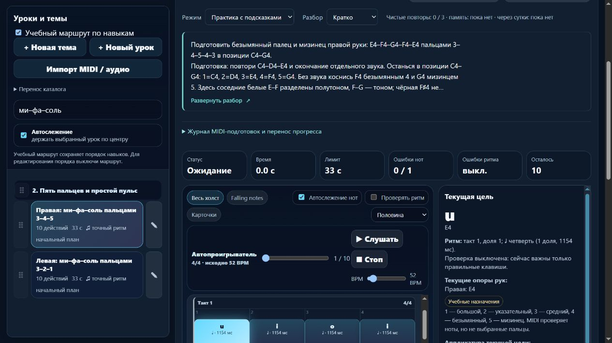

# Партия 34: подготовка правых пальцев 3–4–5 и пятипальцевое движение

7 ноября 2026 года. Локальный выпуск **23.5.34**: **1 новый микроурок, 3 исправленные учебные записи**, новых будущих планов — 0. Все 571 ранее опубликованная музыкальная версия сохранена. Выпуск **выложен и проверен на melodiajest.ru** в [партии эксплуатации 04](melodiajest-operations-2026-11-07-04.md): все 28 публичных файлов, HTTPS, соседние сайты и затронутый браузерный путь прошли проверки.

## Пробел и последовательность

После `course02-02` правая играла C4–D4–E4 пальцами 1–2–3, а `course02-03` сразу требовал 4 и 5. Подходящего раннего задания E4–F4–G4 с обычной артикуляцией не было. Существующие legato-пары требуют более поздней подготовки: назначать их обязательными здесь означало бы создать цикл.

Добавлен `detail-p-right-upper-position-01` — **«Правая: ми–фа–соль пальцами 3–4–5»**, этап p2. Подготовка: `course02-02`, `detail-p-release-01`. Это отдельная цель: спокойно чередовать средний, безымянный и мизинец в одной приготовленной позиции, затем присоединить уже знакомые пальцы 1–2. Рука не растягивается и не фиксируется силой; при неудобстве — остановка и отдых.

- Ноты: **E4–F4–G4–F4–E4**, дважды; MIDI **64–65–67–65–64–64–65–67–65–64**.
- Правая: **3–4–5–4–3–3–4–5–4–3**. Сначала отдельные пары 3–4 и 4–5, затем короткая фраза. E–F — полутон, F–G — тон; F♯ не добавляется.
- Все длительности — четверть, **52 BPM**, 4/4. Начала: **0–4 и 6–10**. Первый E4 отпускается у 5, тишина **5–6**, повтор с нового нажатия E4 у 6. Последнее отпускание у 11; конечная пауза не задана. Счёт продолжается через пятизвучную группу.
- Профиль `standard`: здесь не ставится задача непрерывного legato, staccato, подкладывания большого или подмены удержанного пальца.
- Музыкальная версия **`37aa44c7`**. Знакомая открытая проба переноса: **F4–G4–F4–E4**, пальцы **4–5–4–3**, по четверти. Это ручная проверка применения с другим стартом, не новый урок, неизвестный слуховой тест или MIDI-доказательство владения пальцами.

`course02-02` получил именованный следующий шаг к новому мостику; его прежний разбор и архив предыдущей редакции сохранены. `course02-03` и `course02-04` получили полный разбор движения вверх/вниз, подготовку по ID, точную паузу, слуховой образ, ошибки, самопроверку и перенос в другой порядок. Это пятипальцевые фигуры **C4–G4**, не полные гаммы.

| ID | Ноты одной группы, дважды | Правая | Темп | Сохранённая музыкальная версия |
| --- | --- | --- | ---: | --- |
| course02-02 | C4–D4–E4–D4–C4 | 1–2–3–2–1 | 60 | b623c94b |
| course02-03 | C4–D4–E4–F4–G4 | 1–2–3–4–5 | 60 | eeb8149f |
| course02-04 | G4–F4–E4–D4–C4 | 5–4–3–2–1 | 60 | c315c54f |

В этих трёх старых записях сохранены четверти, начала **0–4 и 6–10**, тишина **5–6** и окончание у 11. Перед возвратом G4→C4 либо C4→G4 используется пауза, промежуточных нот нет. Маршрут: `course02-02` → новый мостик → `course02-03` → `course02-04` → `course02-05`; все требования расположены раньше зависимого урока, циклов нет. Блок около **3–5 минут**, возврат после перерыва и повтор на следующий день не обещают автоматического освоения.

## Источники и границы

Прочитаны повторно **07.11.2026**, применение добавлено к существующим записям журнала источников:

- **Jerry Kovarsky**, Yamaha, *The Basics Of Piano Keyboard Fingering*, 28.11.2023, **The Basics / Scenario One: Everything Fits Under Your Fingers**: номера пальцев и приготовленная позиция. [Авторская статья](https://hub.yamaha.com/keyboards/k-how-to/the-basics-of-piano-keyboard-fingering/).
- **Bob Duke и Amy Simmons**, University of Texas Center for Music Learning, *Tips for Effective Practice*: небольшая посильная цель, представление звука, другой старт, распределённая практика и комфорт. [Авторский материал](https://cml.music.utexas.edu/online-resources/intelligent-music-practice/10-tips-for-effective-practice).

Точные рисунки, темпы 52/60, перенос, продолжительность занятия и числовые MIDI-допуски — решения проекта. Источники не утверждали наши карточки и не рекомендовали именно этот этюд. Все четыре записи обозначены как **техническая отработка проекта**; исторические цитаты и знаменитые ученики не добавлены. MIDI не определяет пальцы, удобство и качество звукоизвлечения; независимой преподавательской проверки нет.

## Сохранность и небольшое улучшение системы

`reviewRightFiveFingerPreparation` применяет исправления только к совпавшей исходной инструкции, музыке, пальцам и классификации. Исходные отпечатки инструкций: **b64c79b7 / a0477a4a / d60d6753**. Личные правки, собственный review и `piece` не заменяются. Предыдущий текст, музыкальная версия и вложенная редакция `three-finger-reading-preparation-v1` архивированы; повторная миграция ничего не меняет. `lesson-review-baseline.js` не пересоздавался.

Для проверки сохранности снят независимый снимок **опубликованного 23.5.33 до изменений**: `tests/fixtures/piano-before-right-five-position-v1.json`, исходный манифест `15c94a486b7d18f65dddadb1999849b651355f850c5f93faa30e07ec30e531cd`. Для всех **571** старых записей совпали SHA256 нот/ритма/пальцев/классификации, оценочная версия, ID, тема и исходный порядок. Загрузчик тестов теперь умеет читать настоящий публичный комплект из отдельного каталога; алгоритм для тестов не копируется.

В реальном DOM найден поиск без label: был только placeholder. В `index.html` добавлены доступные имена **«Поиск урока или темы» / «Поиск произведения или фрагмента»** по выбранному разделу. Это проверено после новой сборки, фильтрация и разделение каталогов сохранены. Применены свежие **web-design-guidelines** из первичного `vercel-labs/web-interface-guidelines` и Computer Use; новые зависимости и плагины не устанавливались. React/Next-код этой партией не менялся.

## Проверки

- **`npm test`: 644/644**, отказов, пропусков и отмен 0; **285327 мс**. Шесть новых регрессий проверяют независимые ноты/пальцы/ритм, все старые музыкальные данные, защищённую миграцию/историю, частные редакции, маршрут и DOM памяти.
- Первый полный прогон обнаружил только **5 устаревших числовых ожиданий** после добавления урока (639/644). Они заменены единым независимым fixture ожидаемых счётчиков; повторный полный прогон выше прошёл. Проверки сохранности и музыкального содержания не ослаблялись.
- `audit:lessons`: 424 пианистические / 456 гитарных учебных записей, после исправлений замечаний 0. `guitarjest` не менялся.
- `audit:fingering`: **0 структурных отказов**, 572 записи, 34530 действий, 39269 нот; начальный корпус **80/1036** прошёл. Сохраняются известные **83 неподдерживаемых действия / 10 помеченных уроков**: 21 unsupported и 62 held-voices. Это ограничения других материалов, не подтверждение их исполнимости.
- `audit:curriculum`: **hardErrors=[]**, 572 пианистические / 713 гитарных записей, 160 начальных MIDI-челленджей. План сгенерирован штатным инструментом.
- `audit:reading-bank`: все 12 примеров остаются опубликованными; **395** совпадений, неизвестных новых заданий 0. Новый мостик не представлен как неизвестный материал чтения.
- `build:web`: версия **23.5.34**, 27 разрешённых ресурсов и манифест; личный каталог и локальные API в публичный комплект не включены.

Настоящий браузер проверил `dist/web` на изолированном **127.0.0.1:56611**, собственная вкладка 85. Enter раскрывает, пробел сворачивает; счётчик нот не меняется. Превью **112/22,4 = 5 строк**. «Скрыто» сохраняется после reload и возвращается доступным селектором. В памяти при всех трёх настройках нет полного блока и кнопки раскрытия, селектор заблокирован. После первого раскрытия свёрнутый полный текст может сохраняться скрытым в DOM; в памяти он удалён. Настоящее MIDI и звук не включались. Доказательства: `docs/qa/piano-2026-11-07-34-browser.json`, снимок ниже.

## Учёт и продолжение

Реализованы **424** учебные записи; MIDI-маршрут **160**; подробно описанное происхождение/редакции **92**; будущие планы **6**; явные повторы цели **6**; контрольные карточки **2**; верхняя оценка разных целей **416**, подтверждённое число разных целей пока неизвестно; независимая преподавательская проверка **0**. Ёмкость матрицы **1310** — плановый бюджет, не готовые уроки. Минимум 1000 ещё не достигнут.

Следующий музыкальный шаг: проверить `course02-05/06` после подготовленного движения вверх/вниз — соединение направлений, соседние пары и повтор C4; сначала точные ноты, паузы, требования и отдельная задача переноса, без изменения старых музыкальных версий ради нового текста. Следующий эксплуатационный шаг после выпуска — собственные ежедневные копии и изолированная проверка восстановления; S3 требует своего подтверждённого namespace и ключей.

Перед выпуском штатный недельный счётчик Codex 10080 минут показал расход **68%**, остаток **32%**, ordinary usage разрешён, spend control не достигнут. Резерв 0%; счётчик общий с другими чатами, точного отсечения не обещает. Commit/push и запись в `guitarjest` не выполнялись.

Выкладка завершена 06.11.2026 22:02:02 UTC / 07.11.2026 03:02:02 Екатеринбург; `current` → `releases/23.5.34-7defa41db5b6`, `previous` → `releases/23.5.33`. До переключения восстановлена копия прежнего выпуска; исходный архив 23.5.34 сохранён на компьютере и VPS, 367 файлов восстановлены на обеих машинах. Полные хеши и ограничения резервирования — в отчёте эксплуатации 04.
