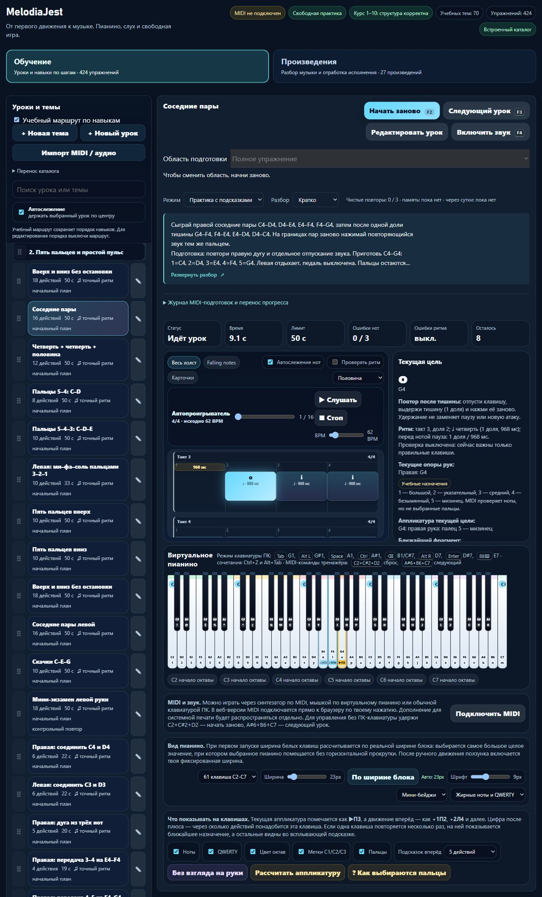

# Партия 35: правая дуга и повторные звуки в соседних парах

7 ноября 2026 года, версия **23.5.35 выложена и проверена на melodiajest.ru**. Уточнены **2 существующих урока**, новых уроков и будущих планов — **0**. Все **572** ранее опубликованных музыкальных набора, оценочные версии, классификация, темы и исходный порядок сохранены. Публикация, собственная копия и изолированное восстановление current/previous подтверждены в [эксплуатационной партии 06](melodiajest-operations-2026-11-07-06.md).

## Что найдено и исправлено

У `course02-05/06` оставались общие инструкции без явных требований и отдельного разбора повторных атак. В дуге C4 повторяется **без паузы**, а в парах G4 повторяется **после одной доли тишины**. Это разные действия; удержание клавиши не заменяет повтор. Подготовка из партии 34 уже доступна, legato-пары более позднего уровня обязательными не назначаются.

### course02-05 — «Вверх и вниз без остановки»

Задача — поменять направление на правом мизинце, сыграв вершину G4 один раз, затем соединить две дуги с новым нажатием C4 большим пальцем. Сначала отдельно разбираются **F4–G4–F4 / 4–5–4** и **C4–C4–D4 / 1–1–2**. Не требуется подкладывание, силовая фиксация кисти или подмена пальца на удержанном звуке.

- Полный MIDI-ряд: **60–62–64–65–67–65–64–62–60–60–62–64–65–67–65–64–62–60**.
- Правая: **1–2–3–4–5–4–3–2–1–1–2–3–4–5–4–3–2–1**.
- **18 четвертей, 64 BPM, 4/4**, начала **0–17**, пауз нет. Первая дуга начинается у 0, вторая у 9, два C4 — у **8 и 9**, последнее отпускание у **18**. Девять нот не превращаются в новый такт; счёт идёт непрерывно.
- Подготовка: `course02-04`, `course02-03`, `detail-p-right-upper-position-01`; следующий — `course02-06`.
- Открытая проба переноса: **D4–E4–F4–G4–F4–E4–D4–D4–E4–D4**, пальцы **2–3–4–5–4–3–2–2–3–2**, по четверти без добавленной паузы. Повторная опора теперь под указательным.
- Сохранённая оценочная версия **`fb8ee7e3`**, исходный отпечаток инструкции **`fbbdeff6`**.

### course02-06 — «Соседние пары»

Задача — соединять пары правой руки с повторным нажатием общей клавиши тем же пальцем. Вверх: **C4–D4 | D4–E4 | E4–F4 | F4–G4**, пальцы **1–2 | 2–3 | 3–4 | 4–5**. Вниз: **G4–F4 | F4–E4 | E4–D4 | D4–C4**, пальцы **5–4 | 4–3 | 3–2 | 2–1**. Черта помогает читать пары и не добавляет пауз. E–F — полутон, соседние белые в остальных парах здесь разделены тоном.

- MIDI: **60–62–62–64–64–65–65–67–67–65–65–64–64–62–62–60**.
- Правая: **1–2–2–3–3–4–4–5–5–4–4–3–3–2–2–1**.
- **16 четвертей, 62 BPM, 4/4**, начала **0–7 и 9–16**. Первый G4 заканчивается у **8**, тишина **8–9**, второй G4 вступает у **9**, последнее C4 отпускается у **17**.
- Тишина — первая доля третьего такта, второе G4 — вторая. Смена направления не сбрасывает счёт. Остальные повторные D4, E4 и F4 не получают добавленной доли тишины.
- Подготовка: `course02-05`, `detail-p-right-upper-position-01`, `detail-p-release-01`; следующий — `course02-07`.
- Перенос вне MIDI-зачёта: **E4–F4 | F4–G4**, тихая доля, **G4–F4 | F4–E4**; пальцы **3–4–4–5, пауза, 5–4–4–3**. Звуки по четверти; пауза после четырёх звуков.
- Сохранённая оценочная версия **`28c4e84b`**, исходный отпечаток инструкции **`acf27e31`**.

Оба разбора содержат цель, приготовленную позицию C4–G4, медленные части, слуховой образ, ошибки, самопроверку и остановку при напряжении. Профиль **standard** сохранён; отдельный legato/staccato не введён. Блок **3–5 минут**, возврат после перерыва и память на следующий день — структура практики, не обещание освоения. Знакомые открытые варианты переноса не считаются неизвестными слуховыми/нотными тестами, дополнительными уроками или автоматическим зачётом пальцев.

## Первичные источники

Повторно прочитаны **07.11.2026**, две связанные записи добавлены к применению трёх источников в журнале:

- **Jerry Kovarsky**, Yamaha, *The Basics Of Piano Keyboard Fingering*, 28.11.2023, **The Basics / Scenario One**: нумерация и предварительно выбранная позиция. [Авторская статья](https://hub.yamaha.com/keyboards/k-how-to/the-basics-of-piano-keyboard-fingering/).
- **Bob Duke и Amy Simmons**, University of Texas Center for Music Learning, *Tips for Effective Practice*: небольшая посильная цель, слуховое представление, другой старт и распределение практики. [Авторский текст](https://cml.music.utexas.edu/online-resources/intelligent-music-practice/10-tips-for-effective-practice).
- **Carl Czerny**, *Briefe über den Unterricht auf dem Pianoforte*, **Dritter Brief, маркеры исходных страниц 20–21**: различие длительности удержания и паузы, своевременное отпускание. Прочитаны цифровая транскрипция KölnKlavier/Wolfgang Lempfrid и титул **Wien, A. Diabelli und Comp.**, дата на транскрибированном титуле отсутствует. Это не факсимиле. [Третье письмо](https://www.koelnklavier.de/quellen/czer-brf/brief-03.html), [титул](https://www.koelnklavier.de/quellen/czer-brf/_titel.html).

Точные рисунки, пальцы в этой позиции, темпы 64/62, длительность занятия, перенос и MIDI-допуски — решения проекта. Обе карточки обозначены как **технические упражнения проекта**, не упражнения Czerny или уроки, утверждённые авторами. Истории о знаменитых учениках и неподтверждённые цитаты не добавлены. Независимой преподавательской проверки и проверки настоящей рукой нет.

## Сохранность и полезное улучшение практики

`reviewRightPositionFlow` применяет исправление только к совпавшей исходной инструкции/музыке без собственного review. Сохраняются предыдущие description/guide/learning и оценочная версия; повторная миграция идемпотентна. Личные тексты, пальцы, ритм, требования, собственный review и `piece` защищены. Исходный `lesson-review-baseline.js` не пересоздавался.

Независимый снимок опубликованного **23.5.34 до изменений** — `tests/fixtures/piano-before-right-position-flow-v1.json`, манифест **`7defa41db5b6eb5e56f4556460720fd7cea9813d72f51ec68d6291030fd4d417`**. Для всех **572** записей совпали SHA256 steps/rhythm/fingeringSpec/contentKind, оценочные подписи, ID, темы и исходный порядок. Частные каталоги и старые ключи прогресса проходят roundtrip без перезаписи.

Для правых пар включён существующий проверенный **`repeatSilenceCue='beat-gap-v1'`**. Текущая цель отличает обычный повтор D4/E4/F4 от G4 после паузы и показывает **«Повтор после тишины … 1 доля»**. Общий алгоритм зачёта и гитарный UI не менялись. Это полезное применение имеющегося контракта, без нового отдельного оценщика или библиотеки.

## Проверки

- **`npm test`: 653/653**, отказов/пропусков/отмен 0, **241580 мс**. Новые целевые **8/8**: независимые ноты/пальцы/ритм, все 572 старые версии, защищённая миграция, приватные правки, маршрут, настоящий MIDI-оценщик, реальный presenter и перенос каталога/прогресса.
- Первый целевой прогон дал 7/8: тест ошибочно ожидал сырые order=990/989 после импорта, который штатно перенумеровывает позиции. Исправлено ожидание относительного порядка, дополнительно проверены неизменные оценочные ключи и реальный `state.learningProgress`; поведение приложения не ослаблялось.
- Настоящий оценщик принимает полные независимые события и отвергает удержанный C4 вместо двух атак, начало второго G4 на долю раньше и неверную октаву. Это не определение сыгранных пальцев.
- `audit:lessons`: после исправлений замечаний 0. `audit:fingering`: **structuralFailures=[]**, начальный корпус **80/1036** прошёл; известные **83 неподдерживаемых действия / 10 уроков** сохраняются.
- `audit:curriculum`: **hardErrors=[]**, **572** пианистические / **713** гитарных записей, **160** MIDI-челленджей. `audit:piano-coverage`: реализовано **424**, подробно описано происхождение/редакции **94**.
- `build:web`: **23.5.35**, 27 разрешённых ресурсов и манифест, browser-only private storage. Корень проекта и локальные API не публикуются; папка `guitarjest` не менялась.

### Настоящий изолированный браузер

Вкладка **86**, **127.0.0.1:63797**, новый origin с отдельными данными. Проверены Enter/пробел, полное происхождение и источники, превью **112/22,4 = 5 строк**, скрытый вид после reload и доступный возврат. Переход к `course02-05` клавиатурой передал фокус заголовку H2. Следующий шаг из дуги открыл правые пары.

В свободной практике нажаты первые восемь виртуальных клавиш; после D4 виден обычный повтор, перед вторым G4 — **целая доля тишины**, текущая цель такт 3 / доля 2. Ритмическая проверка была выключена; звук и настоящее MIDI не включались, исполнение не зачтено. В памяти при всех трёх настройках отсутствуют полный блок, кнопка раскрытия и repeat-подсказка, селектор заблокирован. Доказательства — `docs/qa/piano-2026-11-07-35-browser.json`.

Применены перечитанные **web-design-guidelines** из первичного vercel-labs/web-interface-guidelines: клавиатура, фокус, длинное содержимое и доступные сообщения. Переиспользован проектный find-skills и ранее проверенные первичные репозитории; Computer Use проверил настоящий браузер. Новые навыки, зависимости и плагины не устанавливались; React/Next этой партией не менялся.

## Учёт и следующий шаг

Учебные записи **424**, MIDI-маршрут **160**, подробное происхождение/редакции **94**, отдельные будущие планы **6**, явные повторы цели **6**, контрольные карточки **2**. Верхняя оценка целей **416** не является подтверждённым числом самостоятельных целей; независимая преподавательская проверка **0**, ёмкость карты **1310** не равна готовым урокам. Минимум 1000 ещё не достигнут.

Следующая учебная партия: `course02-07/08`, пропуски C4–E4–G4 и контроль знакомых движений. Сверить точную музыку, подготовку, паузы и роль контрольной карточки; сохранить старые оценочные версии при правке только объяснений. Следующий эксплуатационный этап после публикации — проверить фактическое календарное срабатывание собственных таймеров и подготовить собственную внешнюю S3-копию/шифрование и ограниченную ротацию без чужих ключей.

Перед исследованием расход Codex был 69%, перед полной проверкой 70% — остаток **30%**, ordinary usage разрешён, spend control не достигнут. Резерв **0%**, прежний порог 30% не применялся. Копии перед партией подтверждены в эксплуатации 05; личный браузерный прогресс ими не покрывается. Commit/push не выполнялись.

После публикации проверены 28 публичных файлов, HTTPS, соседние сайты и настоящий браузер на домене. Current — `releases/23.5.35-ff83e6174fa6`, previous — `releases/23.5.34-7defa41db5b6`; оба восстановлены и проверены в отдельных Nginx. Первая плановая health-проверка зафиксировала ещё не завершённую копию новой версии; после backup/restore health успешен. Вкладка 86 закрыта, preview 63797 остановлен, пользовательская 4173 сохранена. Полные хеши, квитанции и различие ручных/плановых проверок — в отчёте эксплуатации 06.
