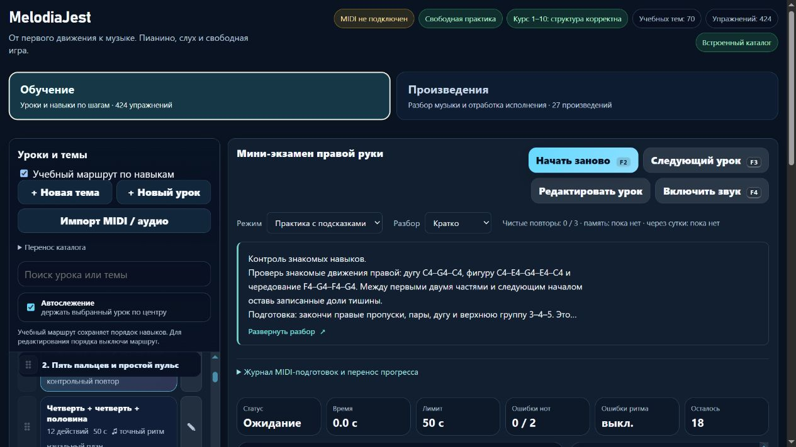

# Правая рука: шаги, пропуски и контроль знакомых движений

7 ноября 2026, партия 36, локальная версия **23.5.36**. Исправлены **два существующих микроурока**, новых записей — **0**. Проверены разбор, подготовка и открытый перенос; мини-экзамен теперь явно учитывается как составной контроль. Все **572** прежние музыкальные payload/оценочные подписи, ID, темы и порядок сохранены. Веб-публикация выполняется следующей отдельной эксплуатационной фазой, [партия 08](melodiajest-operations-2026-11-07-08.md).

## Что исправлено

### course02-07 — «Шаги и скачки C–E–G»

Теперь сравниваются реальные три группы: **C4–D4–E4 / 1–2–3**, **C4–E4–G4 / 1–3–5**, **G4–E4–C4 / 5–3–1**. Это последовательные звуки, не удержанное трезвучие; D4/F4 не добавляются внутрь пропусков. C–E — большая терция (4 полутона), E–G — малая (3); соседние белые клавиши не задают одинаковое расстояние для всех интервалов. Кисть может удобно сопровождать пальцы, жёсткая фиксация не требуется.

- MIDI: **60, 62, 64, 60, 64, 67, 67, 64, 60**.
- **9 четвертей, 62 BPM, 4/4**, начала **0, 1, 2, 4, 5, 6, 8, 9, 10**; тишина **3–4** и **7–8**. G4 после второй паузы требует новой атаки мизинца; последнее C4 отпускается у **11**, конечная пауза не выдумана.
- Подготовка: `course02-06`, `course02-05`, `detail-p-right-upper-position-01`; далее `course02-08`.
- Открытая проба переноса вне зачёта: **D4–E4–F4 / 2–3–4**, доля тишины, **D4–F4–G4 / 2–4–5**, четвертями. В ней соседние E4–F4 разделены полутоном. Это новая опора для сравнения движений, не неизвестный тест слуха или отдельный урок.
- Исходный отпечаток инструкции **`f77db2e1`**, сохранённая оценочная подпись **`f9908024`**.

### course02-08 — «Мини-экзамен правой руки»

Контроль соединяет **дугу C4–D4–E4–F4–G4–F4–E4–D4–C4 / 1–2–3–4–5–4–3–2–1**, **C4–E4–G4–E4–C4 / 1–3–5–3–1** и **F4–G4–F4–G4 / 4–5–4–5**. Прежнее обещание всех «пар» уточнено: в конце чередуется одна верхняя пара. Окончание — **G4**, дополнительное C4 не добавляется.

- **18 четвертей, 66 BPM, 4/4**, начала **0–8, 10–14, 16–19**. Паузы **9–10** и **15–16**, финальное отпускание у **20**, всего пять тактов. Два C4 вокруг первой паузы — отдельные нажатия большого.
- Подготовка: `course02-07`, `course02-06`, `course02-05`, `detail-p-right-upper-position-01`; далее `detail-p-dyads-01`, где общее вступление/отпускание C4+E4 готовится отдельно от последовательных пропусков.
- Перенос вне зачёта меняет порядок знакомых частей: верхняя пара → доля тишины → фигура C4–E4–G4–E4–C4 → доля тишины → полная соседняя дуга. Пальцы прежние, новое окончание — C4. Это открытая проба, не новый урок и не неизвестное слуховое задание.
- Роль **`goalCounting='checkpoint-only'`**: запись и прогресс сохраняются, новая самостоятельная цель не прибавляется.
- Исходная инструкция **`78000732`**, прежняя оценочная подпись **`db25a49e`**.

Оба разбора дают подготовку, медленные части, счёт, руки/пальцы, слуховой ориентир, ошибки, самопроверку и следующий шаг. Профиль **standard** сохранён, отдельного legato/staccato не введено. Предусмотрен блок **3–5 минут**, отдых, возврат после перерыва и память на следующий день. Это структура практики, не обещание освоения или автоматическая проверка пальцев.

## Первичные источники

Прочитаны **07.11.2026**, применение к двум ID добавлено в журнал:

- **Jerry Kovarsky**, Yamaha, *The Basics Of Piano Keyboard Fingering*, 28.11.2023, **The Basics / Scenario One** — номера 1–5 и заранее выбранная удобная позиция. [Авторская статья](https://hub.yamaha.com/keyboards/k-how-to/the-basics-of-piano-keyboard-fingering/).
- **The Open University**, *An introduction to music theory*, **§7, Example 63 и следующий абзац** — состав C–E–G, большая C–E и малая E–G терции. Этот гармонический источник не назначает наши пальцы или учебную последовательность. [Раздел](https://www.open.edu/openlearn/history-the-arts/music/an-introduction-music-theory/content-section-7).
- **Bob Duke и Amy Simmons**, UT Center for Music Learning, *Tips for Effective Practice* — малая посильная цель, слуховой образ, изменённый старт и распределение практики. [Авторский текст](https://cml.music.utexas.edu/online-resources/intelligent-music-practice/10-tips-for-effective-practice).
- **Carl Czerny**, *Briefe über den Unterricht auf dem Pianoforte*, **Dritter Brief, маркеры исходных страниц 20–21** — различение удержания и паузы, своевременное отпускание. Проверены цифровая транскрипция KölnKlavier/Wolfgang Lempfrid и титул **Wien, A. Diabelli und Comp.**, без даты на транскрибированном титуле. Это не факсимиле. [Письмо](https://www.koelnklavier.de/quellen/czer-brf/brief-03.html), [титул](https://www.koelnklavier.de/quellen/czer-brf/_titel.html).

Карточки честно названы **техническим материалом проекта**. Ноты, пальцы данной позиции, темпы 62/66, длительность блока, варианты и MIDI-допуски — решения проекта. Эти уроки не выдаются за упражнения Czerny или материал, утверждённый авторами. Историй о знаменитых учениках и выдуманных цитат нет. Настоящая рука, инструмент и независимая преподавательская экспертиза не проверялись.

## Сохранность и интерфейс

`reviewRightSkipsAndCheckpoint` действует только при совпадении полного исходного отпечатка и исходного exam-флага, отсутствии собственного review и классификации `piece`. Сохраняются предыдущие description/guide/learning и оценочная подпись, повтор идемпотентен. Личные тексты, ритм, пальцы, подготовка, роль цели и собственные редакции защищены. Исходный `lesson-review-baseline.js` не пересоздавался.

Независимый снимок **23.5.35 до правки**: `tests/fixtures/piano-before-right-skips-checkpoint-v1.json`, публичный манифест **`ff83e6174fa68d342cfa0ddfca33cb7129cba92d5f6d71f54e7c3cdf5f11d2fa`**. Исходные карточки — `piano-right-skips-checkpoint-v1.json`. Для всех 572 записей сравнены SHA256 steps/rhythm/fingeringSpec/contentKind и старые оценки; перенос приватного каталога, относительного порядка и прежних ключей прогресса проверен без перезаписи.

Полезные улучшения практики: существующий **`repeatSilenceCue='beat-gap-v1'`** показывает повтор G4 после паузы и C4 в контроле; существующее представление контроля поясняет его роль. Браузер выявил высоту кнопок подготовки **37,68 px** на 390 px. В собственном `piano-learning-ui.css` добавлен `min-height:44px`; после пересборки четыре кнопки имеют **44 px**, подписи помещаются. Общий гитарный модуль и каталог не менялись.

## Проверки

- До исправления целевые проверки: **4/8 pass**; воспроизведены отсутствие контракта подготовки/контроля и паузной подсказки. После исправления **8/8**.
- Полный **npm test: 662/662**, отказов/пропусков/отмен **0**, **291412,646 мс**. Первый полный прогон был 661/662: прежний тест правых чёрных клавиш ожидал короткий список предков без новой подготовки course02-08. Обновлён точный набор всех подготовок; проверки той же руки, порядка и отсутствия циклов сохранены. Приложение ради теста не ослаблялось.
- После финальной CSS-правки и уточнения фразы о паузах отдельно **23/23**: web-release, piano-learning-ui и новая музыкальная регрессия; итоговая сборка повторена. Полный npm-прогон выполнен до этих двух малых правок; после них проверены реальные модули, сохранение всех прежних музыкальных версий и итоговая сборка. Высота кнопок подтверждена браузером.
- `audit:lessons`: после исправлений замечаний **0**. `audit:fingering`: **structuralFailures=[]**, начальный корпус **80/1036** прошёл; известные **83 неподдерживаемых действия / 10 уроков** не скрыты.
- `audit:curriculum`: **hardErrors=[]**, **572** пианистических и **713** гитарных записей, **160** MIDI-челленджей. `audit:piano-coverage`: обучение **424**, подробное происхождение/редакции **96**.
- Настоящий оценщик принимает точные события и отвергает сокращение каждой паузы, удержанный G4/C4 вместо нового нажатия и неверную октаву. MIDI не доказывает сыгранные пальцы.
- `build:web`: **23.5.36**, 27 разрешённых ресурсов и манифест, browser-only storage; корень проекта и локальные API не публикуются.

### Изолированный браузер

Собственная вкладка **87**, **127.0.0.1:54868**, отдельный origin. Превью **112/22,4 = 5 строк**, Enter раскрывает, пробел сворачивает, «Скрыто» переживает reload и возвращается доступным селектором. Во всех трёх видах в памяти нет карточки, body, раскрытия и нотных/паузных подсказок; селектор заблокирован. Подготовка через Enter переводит фокус на H2, «Дальше» открывает контроль правой руки.

В свободной практике нажаты первые шесть виртуальных клавиш: текущая цель G4 показывает **«Повтор после тишины … 1 доля»**, такт 3 / доля 1. Настоящее MIDI/звук не включались, исполнение не зачтено. На 390 px нет общего горизонтального переполнения; кнопки подготовки после исправления 44 px. Временный viewport сброшен. Проверочный вызов превысил timeout; та же вкладка восстановлена, оставшиеся действия выполнены и проверены меньшими партиями. Доказательства — `docs/qa/piano-2026-11-07-36-browser.json`.

Прочитаны проектные find-skills и web-design-guidelines; проверены skills.sh и свежие первичные правила Vercel (доступные имена/клавиатура/фокус, длинный текст, touch targets). Computer Use применён через API браузера к собственной сборке. Новые навыки, библиотеки и плагины не устанавливались; React/Next не менялись.

## Учёт и продолжение

Остаются **424** учебные записи, **160** MIDI-route, **6** будущих планов, **6** явных повторов одной цели; подробно описанных/связанных с доменами теперь **96**, контролей **3**. Верхняя оценка целей **415** после исключения повторов/контролей не является подтверждённым числом самостоятельных целей. Независимая преподавательская проверка **0**; ёмкость карты **1310** не равна готовым урокам. Минимум 1000 ещё не достигнут.

Музыкальный курсор — **course02-08**. Следующая учебная партия — **course04-01/05**: равные четверти и полная доля тишины, их подготовка, пальцы/отпускания и отдельный перенос; сопоставить с уже проверенными половинными/целыми и не прибавлять повторения одной цели. Внешний S3 по-прежнему ждёт собственного защищённого конфига; повторный вопрос о доступе не добавлен. Квота перед выпуском: расход **73%**, остаток **27%**, ordinary разрешён, reserve=0.

## Отдельная эксплуатационная фаза завершена

В **00:13 UTC** 23.5.36 опубликована через постоянный updater, previous 23.5.35 сохранён. Хеши/HTTPS/служебные пути и новая карточка на домене проверены; backup/restore/health после выпуска подтвердили 36/35 в двух изолированных Nginx. Источники партии сохранены в архиве с SHA256 `c8df28357b517bf60acd3b12adc550dd458a12b878da88a1fa9aaf70bfa2a31b`, 363 выбранных файла; финальные квитанции созданы позже. Подробности — [эксплуатационный отчёт 08](melodiajest-operations-2026-11-07-08.md). Собственная QA-вкладка и preview закрыты, пользовательский localhost сохранён. Commit/push не выполнялись.
