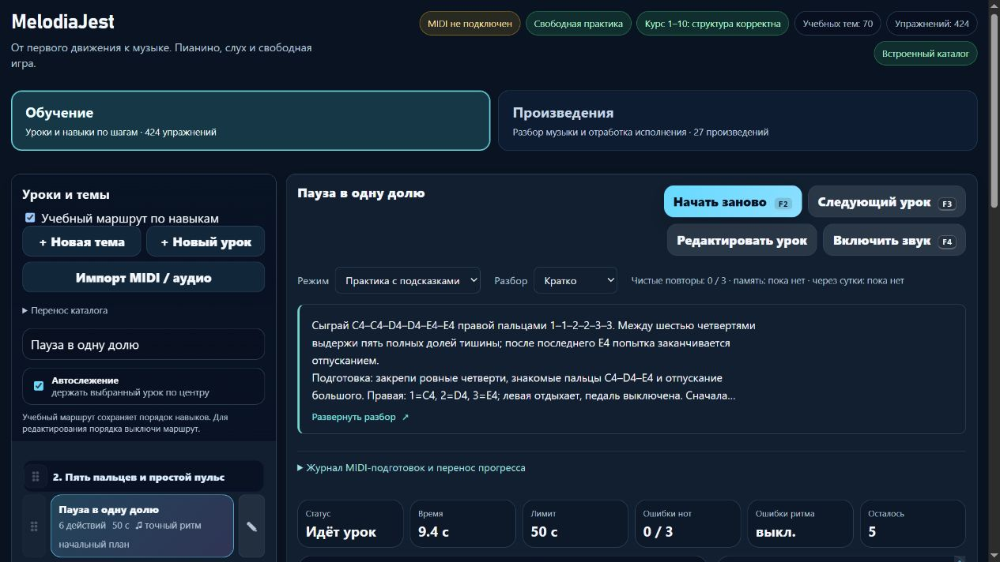

# Партия 37 — четвертной пульс и внутренняя пауза

07.11.2026. **23.5.37 проверена локально, выложена и проверена на домене**. Две полные редакции существующих уроков и одно ограниченное исправление прежней карточки; **новых уроков 0**. Публикация и серверное восстановление — отдельная следующая фаза, [операционный отчёт 09](melodiajest-operations-2026-11-07-09.md).

## Найдено и исправлено

| ID | Неизменные музыкальные данные | Учебная задача и подготовка |
| --- | --- | --- |
| course04-01 | Восемь C4/MIDI 60, правая 1, четверти, начала 0–7, 60 BPM, 4/4; последнее отпускание у 8. Внутренних и конечной пауз нет. Оценочная подпись `1caa7198`. | Непрерывный четвертной пульс через границу такта. Атаки на цифры, произносимое «и» не добавляет ноту. Подготовки course01-01 и detail-p-release-01. |
| course04-05 | C4–C4–D4–D4–E4–E4, правая 1–1–2–2–3–3, четверти, начала 0/2/4/6/8/10, 60 BPM, 4/4; отпускание у 11. Ровно пять внутренних пауз по доле, конечной 11–12 нет. Подпись `c3f45176`. | Полная тихая доля при повторе и переходе к подготовленному следующему пальцу. Подготовки course04-01, course02-02 и detail-p-release-01. |
| detail-p-rhythm-03 | Четыре C4, правая 1, начала 0/2/4/6, четверти, 56 BPM, 4/4; три внутренние паузы, последнее отпускание у 7. Существующий профиль legato и подпись `b069d73d` сохранены. | Только уточнение границы прежнего утверждения: конечная тишина не измеряется **в этом уроке**. Отдельная карточка detail-p-rhythm-final-rest-01 уже существует и проверяет ending.endBeat=4. |

Прежнее «после каждой четверти» у course04-05 могло ошибочно обещать шестую, конечную паузу. Теперь названы пять внутренних промежутков и точное окончание. У course04-01 прямо разделены доля и её половина в голосовом счёте. Обе карточки содержат удобную подготовку, медленные части, счёт, руку/пальцы, ошибки, слуховой образ и измеримый результат. Профиль standard у обеих сохранён, legato/staccato отдельно не вводились.

Открытый перенос вне MIDI-зачёта: у course04-01 после счёта «раз, два» четыре C4 на «три, четыре | раз, два»; у course04-05 обратный порядок E4–E4–D4–D4–C4–C4 пальцами 3–3–2–2–1–1 с теми же пятью паузами. Эти варианты не считаются новыми уроками или независимым слуховым тестом. Практика около 3–5 минут с отдыхом, возвращением после перерыва и памятью на следующий день; срока освоения не обещаем.

У detail-p-rhythm-03 сохранена полная прежняя редакция `early-rhythm-v1`, добавлен отдельный `endingScopeReview=internal-rest-scope-v1`. Внутренние паузы не превратились в новый ending-контракт. Ссылка следующей подготовки хранится по устойчивому ID, в тексте ученику показано название. Глобальная кнопка F3 идёт по линейному маршруту, а не непосредственно по nextLessonId; мгновенный переход F3 к произвольной ветке здесь не заявляется.

## Первичные источники

Прочитаны 07.11.2026; применение к соответствующим ID добавлено в `piano-curriculum-sources.json`:

- **The Open University**, *An introduction to music theory*, **§3.1 Time values**, абзацы у Examples 13–14: отношения длительностей, четверть и восьмая. [Раздел](https://www.open.edu/openlearn/history-the-arts/music/an-introduction-music-theory/content-section-3.1).
- Тот же курс, **§4.1 Values and dots**, начальный абзац / Example 32: соответствующие длительности пауз. [Раздел](https://www.open.edu/openlearn/history-the-arts/music/an-introduction-music-theory/content-section-4.1).
- **Mark Gotham, Chelsey Hamm, Kris Shaffer**, *Open Music Theory: Simple Meter and Time Signatures*, **Example 9 / Counting Simple Meter, Example 10**: в 4/4 долю получает четверть, «and» делит её пополам; допускаются разные системы счёта. [Учебник](https://viva.pressbooks.pub/openmusictheory/chapter/simple-meter-and-time-signatures/).
- **Diana Dumlavwalla**, Yamaha, *Fix It: Tips for Teaching Basic Piano Technique*, 29.11.2021, **Inconsistent Hand Shape**: гибкое запястье и поддержанная форма руки. [Авторская статья](https://hub.yamaha.com/music-educators/instruments/piano/piano-pedagogy-fix-basic-technique/).
- **Bob Duke и Amy Simmons**, UT Center for Music Learning, *Tips for Effective Practice*: малая цель, слуховой образ, изменение старта и распределённая практика. [Авторский текст](https://cml.music.utexas.edu/online-resources/intelligent-music-practice/10-tips-for-effective-practice).

Это **технические упражнения проекта**, не фрагменты произведения и не упражнения указанных авторов. Ноты, позиционные пальцы, русский счёт, 60 BPM, блок 3–5 минут, перенос и допуски оценщика — решения проекта. Источники не подтверждают внутренние возможности нашего MIDI-движка; окончание проверено исполняемым кодом. Биографических атрибуций и вымышленных историй нет.

## Сохранность и проверка

Исходные отпечатки инструкций: course04-01 `1a42315e`, course04-05 `0a719a00`, detail-p-rhythm-03 `55d28458`. Редакция применяется лишь к точному исходнику, с исходным exam=false, без чужого review и без классификации piece. Архивированы прежние description/guide/learning и оценочная подпись. Для ограниченной правки сохранён также старый contentReview. Личные изменения и повторное применение защищены.

Снимки сняты **до правки** из проверенной опубликованной 23.5.36, manifest SHA256 `690997551ce98e2ace71b3eb962597e3c1f488eac713c9f2d6d2fc569c6537f1`: `tests/fixtures/piano-quarter-pulse-rests-v1.json` и `piano-before-quarter-pulse-rests-v1.json`. Сравнены все **572** прежние музыкальные payload/оценочные подписи, ID, порядок и классификация. Перенос частного каталога и прогресса проверен без перезаписи старых ключей. `lesson-review-baseline.js` не пересоздавался; guitarjest не изменялся.

- До исправления целевые тесты: **4/10 pass**, воспроизведены шесть отсутствующих инструкционных/маршрутных контрактов. После — **10/10**.
- Полный **npm test: 672/672**, fail/skip/cancel 0, **267910,6495 мс**. После двух финальных улучшений формулировок отдельно **22/22**: новая музыкальная регрессия, прежние ритмические редакции и web-release. Эти малые текстовые изменения выполнены после полного прогона; повторная итоговая сборка успешна.
- Настоящий оценщик принимает точные MIDI-события, отвергает сокращение каждой внутренней паузы, удержание вместо повтора и лишнюю атаку на «и». Настоящие обработчики on/off заканчивают три попытки лишь последним отпусканием у 8/11/7; отдельный конечный ending остаётся у своего урока.
- `audit:lessons`: после исправлений замечаний 0. `audit:fingering`: structuralFailures=[], начальные **80 уроков / 1036 назначений** прошли. Известные **83 неподдерживаемых действия в 10 уроках** остаются видимыми.
- `audit:curriculum`: hardErrors=[], 572 пианистические и 713 гитарных записей, **160** MIDI-маршрутных уроков. `audit:piano-coverage`: 424 учебных записи, **98** с подробным происхождением/редакцией.
- `build:web`: **23.5.37**, 27 разрешённых ресурсов и манифест; локальные API и корень проекта не публикуются.

### Изолированный браузер

Собственная вкладка **88**, отдельный origin **127.0.0.1:58162**. Подтверждены тексты обеих карточек и ограниченное исправление третьей. Превью **112 / 22,4 = пять строк**, Enter раскрывает, пробел сворачивает. «Скрыто» переживает reload, селектор доступен для возврата. Во всех трёх видах в режиме памяти карточка, body, раскрытие и нотные/паузные ответы отсутствуют в DOM, селектор заблокирован.

Свободная практика первой виртуальной C4 показывает обычный повтор у четвертей и **«Повтор после тишины … 1 доля»** у course04-05. При 390×844 общий документ не шире viewport, три подготовки имеют высоту **44 px**; Enter по подготовке переводит фокус на H2 нужного урока. Итоговый текст повторно прочитан после пересборки, временный viewport сброшен. MIDI/звук не включались, виртуальная практика не объявлена зачётом.

[Браузерная квитанция](../qa/piano-2026-11-07-37-local.json).

Применены ранее прочитанные проектные find-skills и web-design-guidelines: свежие skills.sh и первичные Vercel-правила, явные подписи/раскрытие, удобочитаемый текст, отсутствие подсказок в памяти, мобильные цели и фокус. Реестр применения обновлён. Новых навыков, библиотек, плагинов и React-экранов нет.

## Учёт и продолжение

По-прежнему **424 реализованные учебные записи**, **160** MIDI-маршрутных, **98** с подробной редакцией, **6** конкретных будущих планов. **6** явных повторных вариантов и **3** контрольных задания исключены из прироста целей; **415** — верхняя граница после этих исключений, не независимо подтверждённое число разных навыков. Независимо проверенных преподавателем 0; 1310 мест матрицы не являются 1310 готовыми уроками. Минимум 1000 ещё не достигнут.

Следующий музыкальный этап: **course04-06/07**, пары восьмых и счёт 3/4 — сверить отдельные цели, подготовку, конкретный ритм, пальцы и перенос, сохранив старые музыкальные версии. Ближайшая эксплуатационная фаза — проверенная выкладка 23.5.37 и backup/restore current/previous. Доступ собственного S3 по-прежнему ожидается; независимая внешняя копия не объявлена готовой. Настоящее MIDI, удобство руки и педагогическая экспертиза не подменяются зелёными тестами.

## Публикационная квитанция

В [фазе 09](melodiajest-operations-2026-11-07-09.md) штатный updater завершил выпуск 23.5.37, previous 23.5.36 сохранён. Проверены 27 публичных хешей/HTTPS, карточки и память на домене; оба выпуска и их исходные артефакты восстановлены в изоляции. Новых уроков и преподавательских зачётов эксплуатационные операции не добавляют. Своя вкладка 88 и preview 58162 закрыты; пользовательский 4173 сохранён.
