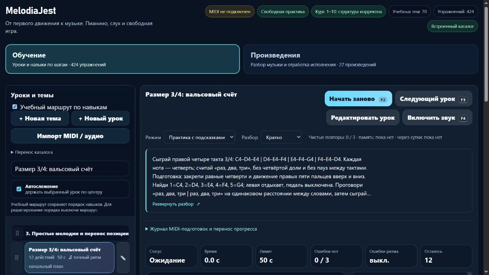

# Партия 38 — пары восьмых, 3/4 и мобильный выбор урока

07.11.2026. **23.5.38 проверена локально, выложена и проверена на домене**: две полные редакции существующих карточек и исправление измеренного мобильного сбоя. Новых уроков 0. Выпуск — отдельная [операционная фаза 10](melodiajest-operations-2026-11-07-10.md).

## Музыкальная проверка

| ID | Сохранённые данные | Цель и подготовка |
| --- | --- | --- |
| course04-06 «Восьмые парами» | Дважды C4–D4–E4–F4–G4–F4–E4–D4, правая 1–2–3–4–5–4–3–2. 16 восьмых, 60 BPM, 4/4. Начала 0/0,5/1/1,5/2/2,5/3/3,5 и 5/5,5/6/6,5/7/7,5/8/8,5. Единственная пауза 4–5, последнее отпускание у 9. Подпись `8cea360f`. | Перенос равных половин доли на подготовленную пятипальцевую дугу и возвращение после тишины на другую долю такта. Требуются detail-p-rhythm-04, course02-05, course04-05. |
| course04-07 «Размер 3/4: вальсовый счёт» | C4–D4–E4 / D4–E4–F4 / E4–F4–G4 / F4–E4–D4. Правая 1–2–3 / 2–3–4 / 3–4–5 / 4–3–2. 12 четвертей, 66 BPM, 3/4, начала 0–11, отпускание у 12; пауз нет. Подпись `3f362035`. | Четыре трёхдольных такта с меняющейся первой нотой. Требуются course04-01 и course02-05; владение восьмыми не является обязательной предпосылкой 3/4. |

У восьмых прежний короткий текст не объяснял целую тихую долю. Теперь явно: первое «раз-и» второго такта проходит в тишине, вторая группа вступает на **«два-и»**, а её последние E4–D4 приходят на «раз-и» третьего такта. Данные не превращены в два непрерывных такта, конечная пауза не добавлена. У 3/4 нет четвёртой доли или остановки на тактовой черте. «Вальсовый счёт» здесь — упражнение размера, дальнейшее сопровождение требует отдельной подготовки.

Сохранён профиль standard. Добавлены понятные цель/применение, позиция и номера пальцев, малые части разбора, счёт, ошибки, слуховой образ и самопроверка. Открытый перенос вне зачёта: для восьмых E4–F4–G4–F4–E4–D4–C4–D4 (3–4–5–4–3–2–1–2), восемь восьмых за один такт; для 3/4 D4–E4–F4 / E4–D4–C4 (2–3–4 / 3–2–1), шесть четвертей за два такта. Это не новые уроки или неизвестные слуховые задания. Блок около 3–5 минут с отдыхом, возвратом после перерыва и памятью на следующий день.

Обе записи в p3. Фактический маршрут ставит подготовленные четверти в 3/4 раньше пятипальцевых восьмых; следующие рекомендации направлены вперёд: course04-07 → course04-06 → course04-08. Это не заявление, что глобальная F3 перескакивает непосредственно по nextLessonId: она сохраняет линейный маршрут и промежуточные записи.

## Источники и пределы оценки

Прочитаны 07.11.2026, применения к двум ID сохранены в журнале:

- **The Open University**, *An introduction to music theory*, **§3.1 Time values, Examples 13–14** — соотношение четверти и восьмой; **§4.1 Values and dots, начало / Example 32** — соответствующая длительность тишины. [Длительности](https://www.open.edu/openlearn/history-the-arts/music/an-introduction-music-theory/content-section-3.1), [паузы](https://www.open.edu/openlearn/history-the-arts/music/an-introduction-music-theory/content-section-4.1).
- **Mark Gotham, Chelsey Hamm, Kris Shaffer**, *Open Music Theory, Simple Meter and Time Signatures*, **Time Signatures / Example 9, downbeat, Counting / Examples 10–12** — группировка по три/четыре, четвертная доля и её равное деление. [Учебник](https://viva.pressbooks.pub/openmusictheory/chapter/simple-meter-and-time-signatures/).
- **Jerry Kovarsky**, Yamaha, *The Basics Of Piano Keyboard Fingering*, 28.11.2023, **The Basics / Scenario One** — номера 1–5 и подготовленная удобная позиция. [Статья](https://hub.yamaha.com/keyboards/k-how-to/the-basics-of-piano-keyboard-fingering/).
- **Diana Dumlavwalla**, Yamaha, *Fix It: Tips for Teaching Basic Piano Technique*, 29.11.2021, **Inconsistent Hand Shape**, абзац о гибком запястье. Одно чтение дало временную ошибку; повторное чтение первичного адреса успешно. Упражнения с падением руки не переносились. [Статья](https://hub.yamaha.com/music-educators/instruments/piano/piano-pedagogy-fix-basic-technique/).
- **Bob Duke и Amy Simmons**, UT Center for Music Learning, *Tips for Effective Practice*, малая цель / изменение старта / распределение практики. [Авторский текст](https://cml.music.utexas.edu/online-resources/intelligent-music-practice/10-tips-for-effective-practice).

Это **технический материал проекта**, без атрибуции произведению, авторского утверждения карточек или историй о знаменитых учениках. Конкретные ноты, пальцы позиции, русский счёт, 60/66 BPM, блок и допуски — решения проекта.

Регрессия выявила предел уже существующего оценщика: при 60 BPM смещение нечётных восьмых на **200 мс** ещё принимается, на **350 мс** — отвергается. Порог начала равен max(90 мс, 0,22 доли), здесь **220 мс**. Длительности и релизы также имеют свои проверки. Произвольная velocity с неверными акцентами не препятствует clean. Поэтому в карточках явно добавлена самопроверка равенства восьмых и акцента на слух; зелёный MIDI-результат не объявляется идеальной ровностью. Порог/оценочная версия не ужесточались молча. Более строгая точность — отдельный будущий контракт с версионированием, а не повод переписать прежний прогресс.

## Сохранность и тесты

Исходные полные отпечатки инструкций **543516de / 5faca92f**. `reviewEighthPairsAndTripleMeter` работает только при точном совпадении, exam=false, отсутствии собственного review и классификации piece. Архивированы прежние description/guide/learning и оценочные подписи; повтор идемпотентен. Личные тексты, руки/пальцы, время, подготовка, классификация и история защищены.

Снимки сняты до правки с проверенной 23.5.37, manifest SHA256 **`6be3c99922b40d702e3504c2f55d6850704606b2564f5e4c0f89665ca98ebef7`**: `piano-eighth-pairs-triple-meter-v1.json` и `piano-before-eighth-pairs-triple-meter-v1.json` в tests/fixtures. Все **572** прежние payload/оценочные подписи, ID, классификация и относительный порядок сравнены; перенос частного каталога/ключей прогресса проверен. lesson-review-baseline.js не пересоздан, trainer-content.json и guitarjest не менялись.

- До исправления **3/9** целевых прошли, шесть отсутствующих инструкционных контрактов воспроизведены. После — **9/9**. Отдельная первоначальная проверка смещения на 200 мс была исправлена после исследования реального допуска; алгоритм ради ожидания теста не менялся.
- Полный **npm test 681/681**, fail/skip/cancel 0, **254447,5755 мс**. После заключительных CSS/следующих рекомендаций отдельно **24/24** (музыкальная регрессия, piano-learning-ui, web-release), итоговый build:web. Полный прогон выполнен до этих малых последних правок; после них заново проверены реальные модули, все прежние музыкальные версии и сборка.
- Реальный оценщик отвергает пропуск паузы, значительное неравенство восьмых и неверную высоту. Настоящие обработчики MIDI on/off заканчивают записи последними отпусканиями, не добавляя тишину для заполнения неполного такта.
- audit:lessons: замечаний после исправлений 0; audit:fingering: structuralFailures=[], начальные 80/1036 прошли, известные 83 неподдерживаемых действия / 10 уроков остаются видимыми; audit:curriculum: hardErrors=[], 572 пианистические / 713 гитарных записей и 160 MIDI-маршрутных.
- build:web **23.5.38**, 27 разрешённых ресурсов и манифест, без локального content/Windows endpoint.

## Подтверждённое улучшение мобильного каталога

Браузер **89**, отдельный origin **127.0.0.1:63297**. При 390×844 шапка sidebar занимала **389,38 px** внутри фиксированных **360 px**, списку оставалось **24 px**, строка высотой **80,56 px** была обрезана. Нажатие отфильтрованного урока не меняло выбор. Длинная первая цепочка также показала BODY вместо ожидаемого фокуса; отдельные Enter-повторы переводили фокус на H2. Измеренная причина непопадания мышью — обрезанный каталог.

В собственном piano-learning-ui.css на одноколоночном breakpoint панель получила автоматическую высоту, список — минимум 160 и максимум 360 px. После исправления шапка **389,38**, список **161,56 px** (clientHeight 162), панель **552,22**: строка доступна, выбор и возврат после подготовки срабатывают первым нажатием. Enter переводит фокус на H2. Гитарный CSS не менялся, ручные настройки клавиатуры не перезаписывались.

Превью **112/22,4 = пять строк**; Enter/пробел раскрывают/сворачивают, «Скрыто» переживает reload и возвращается селектором. Во всех трёх видах памяти карточка/body/раскрытие и нотные ответы отсутствуют в DOM. После восьми виртуальных нот текущая цель показывает C4, **такт 2 / доля 2**, восьмую 500 мс и паузу 1000 мс. Это свободная практика без MIDI/звука, не зачёт ритма. На 390 px нет общего горизонтального переполнения, подготовки 44 px. Временный viewport сброшен.

[Квитанция](../qa/piano-2026-11-07-38-local.json), [мобильный результат](../qa/piano-2026-11-07-38-mobile.png).

find-skills использован через свежий skills.sh; прочитанные первичные web-design-guidelines применены к тексту, кнопкам, длинному разбору, области прокрутки и реальному мобильному выбору. Установок навыков/плагинов/библиотек, нового React-экрана или заявленного ускорения нет.

## Учёт и продолжение

**424 реализованные учебные записи**, **160** MIDI-маршрутных, **100** с подробными редакциями/происхождением, 6 конкретных будущих планов. Шесть явных повторных вариантов и три контроля не дают прироста целей; **415** остаётся верхней границей, verifiedDistinctGoalCount=null, независимо проверенных преподавателем 0. Матрица на 1310 мест не равна 1310 готовым урокам; минимум 1000 ещё не достигнут.

Следующий музыкальный этап: **course01-03/04 и course03-01** — подготовка двух пальцев обеих рук, фактические паузы и самостоятельность целей двух левых C3–D3. Общий следующий этап для чередования — измерить текущую загрузку/сжатие и стоимость локального каталога перед решением о версионированных частях/S3, без переноса по одному наличию бакета. Доступ собственного S3 остаётся ожидаемым; новую внешнюю копию не заявляем. Настоящее MIDI, физическое удобство и педагогическая экспертиза остаются отдельными проверками.

## Первоначальная серверная отсрочка (завершена)

На первом проходе [фазы 10](melodiajest-operations-2026-11-07-10.md) 23.5.38 была скопирована и файловым способом восстановлена, но выкладка ожидала общей блокировки другой операции. Тогда на домене оставалась проверенная 23.5.37 с 98 подробными редакциями. Свои QA-вкладка/preview были закрыты, пользовательский 4173 сохранён. Возобновление и завершение этой отсрочки подтверждены ниже.

## Завершение публикации

[Фаза 10](melodiajest-operations-2026-11-07-10.md) возобновлена после освобождения реального общего lock: 23.5.38 выложена, previous 23.5.37 сохранён, обе версии и исходники восстановлены в изоляции. Проверены 27 публичных хешей, мобильный выбор/возврат, тексты и все виды памяти на домене. Исходное состояние интерфейса возвращено; отложенная очередь снята. Историческая отсрочка выше не является текущим статусом.
