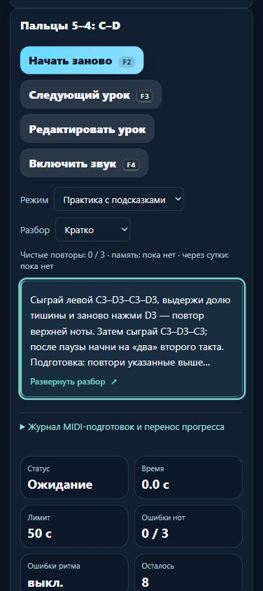

# Первые пары пальцев: две руки и повтор после паузы

07.11.2026. **23.5.39 проверена локально, выложена и проверена на домене**: полные редакции трёх существующих упражнений, без изменения нот, ритма, пальцев и оценочных версий. Выпуск и восстановление обеих версий завершены отдельной [операционной фазой 12](melodiajest-operations-2026-11-07-12.md). Новых уроков **0**.

## Что исправлено

| ID | Проверенные данные | Учебная цель / подготовка |
| --- | --- | --- |
| course01-03 | C4–D4 четыре раза, правая 1–2; восемь четвертей, начала 0–7, отпускание у 8, без пауз; 56 BPM, 4/4. Подпись 688220a6. | Первая смена правого большого и указательного в одной позиции; requires course01-01. Затем detail-p-release-01. |
| course01-04 | C3–D3 четыре раза, левая 5–4; восемь четвертей, начала 0–7, отпускание у 8, без пауз; 56 BPM, 4/4. Подпись 356420d6. | Собственная левая пара и обратный переход 4–5; requires course01-02. Правое упражнение не является обязательной подготовкой. Затем detail-p-release-02. |
| course03-01 | C3–D3–C3–D3 / D3–C3–D3–C3, левая 5–4–5–4 / 4–5–4–5. Начала 0/1/2/3 и 5/6/7/8; четверти, пауза 4–5, отпускание у 9; 56 BPM, 4/4. Подпись 0035c9a1. | Повтор D3 после полной тихой доли, другое начало и направление второй группы; requires course01-04 и detail-p-release-04. Затем course03-02. |

У двух ранних карточек теперь явно указаны восемь четвертей **без внутренней паузы**. У поздней левой запись содержит отдельную цель: первая D3 отпускается у 4, целое «раз» второго такта проходит в тишине; повтор D3 приходит на **«два»** (5). Последние C3–D3–C3 приходят на «три, четыре | раз», отпускание — у «два» третьего такта (9). Длинное удержание D3 не заменяет двух атак. Прежнее «закрепи C3–D3» этой разницы не объясняло.

Это различие музыкального действия, а не новый BPM или переименование. Два левых задания остаются разными существующими целями; число реализованных записей не увеличивается. Физический порядок каталога и ID сохранены. В учебной карте первые пары — p1, связка с паузой — p2 после её левой подготовки; это не требует предварительного освоения правой руки.

В каждом разборе добавлены цель/применение, подготовка, короткий медленный разбор, счёт, пальцы, ошибки, слуховой образ и самопроверка. Не требуются насильственный подъём безымянного, жёсткая фиксация кисти или игра без взгляда при первом знакомстве. Другой профиль артикуляции не вводился, standard сохранён.

Открытый перенос вне MIDI-зачёта: для первых пар начало с D4 или D3; для поздней левой D3–C3, доля тишины, C3–D3 (4–5 / 5–4), начала 0/1 и 3/4. Это подготовленные варианты для самостоятельной практики, не новые уроки и не неизвестные слуховые задания. Блок около 3–5 минут с отдыхом, возврат после перерыва и память на следующий день.

## Источники и происхождение

Прочитаны 7 ноября, применения к ID сохранены в `piano-curriculum-sources.json`:

- **Jerry Kovarsky**, Yamaha, *The Basics Of Piano Keyboard Fingering*, 28.11.2023, **The Basics; Scenario One: Everything Fits Under Your Fingers** — номера пальцев и заранее подготовленная удобная позиция. Конкретные пары и их 56 BPM выбраны проектом. [Первичный текст](https://hub.yamaha.com/keyboards/k-how-to/the-basics-of-piano-keyboard-fingering/).
- **Diana Dumlavwalla**, Yamaha, *Fix It: Tips for Teaching Basic Piano Technique*, 29.11.2021, **Inconsistent Hand Shape, последний абзац о запястье** — гибкость и удобное нейтральное возвращение. Упражнения с падением руки и кругами не переносились. [Первичный текст](https://hub.yamaha.com/music-educators/instruments/piano/piano-pedagogy-fix-basic-technique/).
- **The Open University**, *An introduction to music theory*, **§3.1 Time values, Examples 13–14**, **§4.1 Values and dots, начало / Example 32** — длительности звука и соответствующие длительности тишины. [Ноты](https://www.open.edu/openlearn/history-the-arts/music/an-introduction-music-theory/content-section-3.1), [паузы](https://www.open.edu/openlearn/history-the-arts/music/an-introduction-music-theory/content-section-4.1).
- **Mark Gotham, Chelsey Hamm, Kris Shaffer**, *Open Music Theory*, **Simple Meter and Time Signatures: Time Signatures / Example 9; Counting in Simple Meter / Examples 10–12** — четыре четвертные доли и положение в такте. Русский счёт и точные события этих упражнений — редакция проекта. [Учебник](https://viva.pressbooks.pub/openmusictheory/chapter/simple-meter-and-time-signatures/).
- **Bob Duke, Amy Simmons**, UT Center for Music Learning, *Tips for Effective Practice*, **How much to try and change at one time; How to make changes stick; How to organize practice time over the week** — малая цель, изменённый старт и распределённая практика. [Авторский текст](https://cml.music.utexas.edu/online-resources/intelligent-music-practice/10-tips-for-effective-practice).

Все три карточки обозначены как **технические упражнения проекта**. Это не фрагменты произведений; авторское утверждение карточек и истории об обучении известных исполнителей не заявлены. MIDI проверяет события высоты и времени с допусками проекта, не номера пальцев, свободу движения и качество звука.

## Сохранность и проверки

До правки сохранены реальные данные опубликованной 23.5.38, manifest SHA256 `6a4a36d988c0ca9d716fe03b859d7a2363427562cc5ba76422ed86dfc78cd9cd`: `tests/fixtures/piano-first-two-fingers-v1.json` и `piano-before-first-two-fingers-v1.json`. Проверенная копия исходников — `dist/melodiajest-23.5.38-20261107-38.tar.gz`, SHA `12596a1443bc252ad17d2233a24155f5c2467dcebc8d982831021463a00b8e95`.

`reviewFirstTwoFingers` срабатывает только на полном совпадении исходных инструкций/музыки, exam=false, без личного review и классификации piece. Отпечатки **a29fab60 / e72ce411 / c0d500a5**. Прежние description/guide/learning и оценочные подписи архивированы; повтор идемпотентен. Частные тексты, руки/пальцы, ритм, классификация, порядок и история защищены. `lesson-review-baseline.js`, личный `trainer-content.json` и guitarjest не менялись.

- До исправления целевые **3/9**, шесть отсутствующих инструкционных контрактов воспроизведены; после **9/9**.
- Сравнены все **572** музыкальных payload, оценочных подписи, ID, классификации и относительный физический порядок. Проверен перенос частного каталога и прежних ключей прогресса.
- Настоящий оценщик отвергает пропуск доли тишины и удержанную D3 вместо двух атак. Новые требования не ужесточают допуски и не меняют версию оценки.
- Первый полный прогон **686/690** выявил четыре устаревших ожидания: два счётчика подробных редакций и две точные транзитивные цепочки после добавления course01-04 как подготовки поздней левой связки. Обновлены ожидаемые цепочки с сохранением проверок отсутствия циклов, порядка и **левой руки каждого предка**, а также оба счётчика подробной редакции/направления 100→103.
- Применимые 35 регрессионных тестов затем прошли. Повторный полный **npm test — 690/690**, fail/skip/cancel 0, **283488,3141 мс**. Музыкальный код после него не менялся.
- `audit:lessons`: замечаний после исправлений 0; `audit:fingering`: structuralFailures=[], начальные 80 уроков / 1036 действий прошли; известные неподдерживаемые действия остаются видимыми. `audit:curriculum`: hardErrors=[], 572 пианистические и 713 гитарных записей; 160 MIDI-маршрутных.
- `build:web` — 23.5.39, только allowlist 27 ресурсов и манифест, без локального сервера/каталога и Windows endpoint.

## Браузерный путь

Изолированный origin **127.0.0.1:63339**, своя вкладка **91**. Содержимое всех трёх карточек проверено. Enter раскрывает, пробел сворачивает, мышь раскрывает объяснение паузы. Скрытый вид переживает reload, селектор остаётся доступен. Режим памяти проверен с предварительным выбором каждого из трёх видов: card/body/toggle отсутствуют в DOM, текущая цель содержит только общую инструкцию памяти. Переключатель вида во время памяти штатно заблокирован; тест выбирал настройку перед входом в память.

На **390×844** превью **112 / 22,4 = пять строк**, общего горизонтального переполнения нет; кнопки подготовки **44 px**. Enter по левой подготовке выбирает course01-04 и фокусирует **H2**. Возврат к исходной карточке выполнен через её поиск/выбор. Временный viewport сброшен. Звук, MIDI и микрофон не включались; это не испытание настоящего инструмента.

[Квитанция](../qa/piano-2026-11-07-39-local.json), [мобильный результат](../qa/piano-2026-11-07-39-mobile.png).

Прочитанные find-skills и web-design-guidelines применены через свежие skills.sh / первичный Vercel command.md: ясность задач, клавиатура, компактность, доступная подготовка и скрытие памяти. Существующий визуальный стиль и React/Next-код не менялись. Навыки, зависимости и плагины не устанавливались.

## Учёт и продолжение

**424 реализованные учебные записи**, 160 MIDI-маршрутных, **103** с подробной редакцией/происхождением, 6 конкретных будущих планов. Шесть повторных вариантов и три контроля остаются отдельно; **415 — верхняя граница**, verifiedDistinctGoalCount=null, независимых преподавательских проверок 0. Каркас 1310 мест не означает готовность такого количества уроков; минимум 1000 ещё не достигнут.

Музыкальный курсор: первые пары пальцев завершены; далее **course01-01/02**, реальные паузы и подготовка повторения одной опорной клавиши. Следующий продуктовый этап после проверяемого выпуска — локальный контракт версионированной темы/манифеста по измеренной базе партии эксплуатации 11. Сигнал 02:31:37 UTC принят как последовательное продолжение; параллельная партия не открывалась.

## Публикация завершена

[Фаза 12](melodiajest-operations-2026-11-07-12.md): current/previous 39/38, архив 392 выбранных исходников / 424 элемента восстановлен локально и на VPS; два network-none Nginx и 12 controls проверены. На домене совпали все хеши, три карточки, пятистрочный мобильный вид и отсутствие DOM-подсказок памяти. Исходный интерфейс возвращён; pendingRelease/pendingReview сняты.
