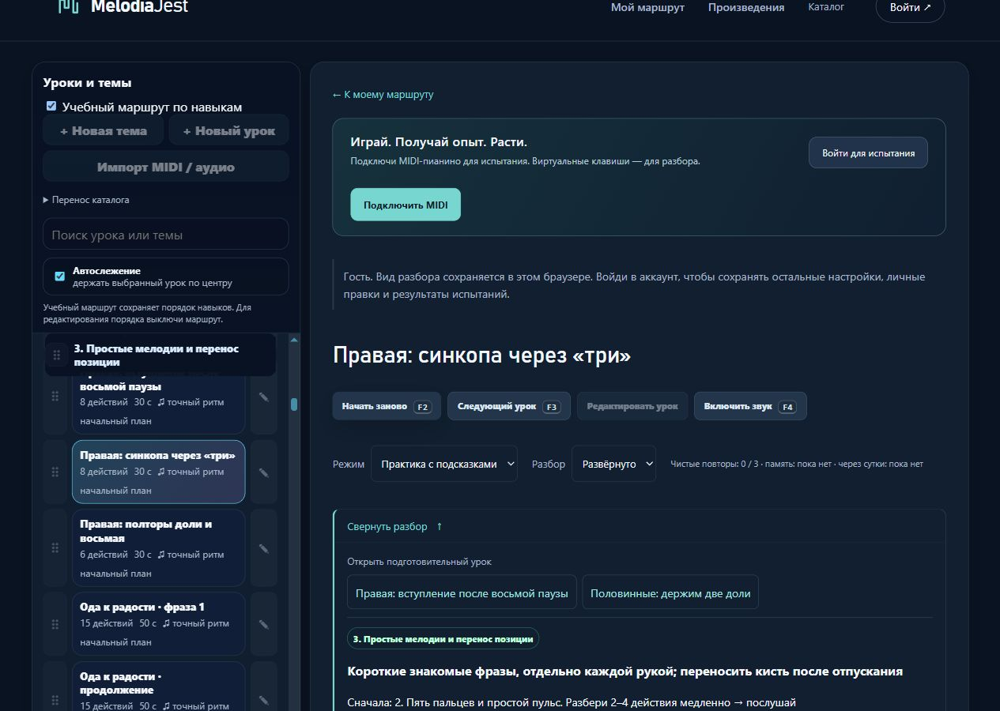

# Курс пианино — партия 2026-11-11-01 опубликована

Версия **23.5.80 опубликована и проверена** 2026-11-11T04:24:16.090943+00:00. Версия 23.5.79 сохранена для отката.

Выпуск содержит два новых технических упражнения проекта:

- `detail-p-eighth-rest-offbeat-right-01`: восьмая пауза на «два», короткая D4 на «два-и», E4 на «три».
- `detail-p-syncopation-hold-right-01`: D4 начинается на «два-и» и держится через «три» до «три-и», без повторного нажатия.

Сохранение гостевого выбора «Кратко / Развёрнуто / Скрыто» проверено после перезагрузки. В отдельном ключе остаётся только это неперсональное значение; приватные гостевые правки и результаты временные. Аккаунт сохраняет приоритет.

[Браузерная проверка](../qa/melodiajest-2026-11-11-111-browser.json) выполнена на изолированном preview и на действующем сайте: оба урока, подготовка, счёт, пальцы, источники, мышь, Enter, пробел и фокус. На ширине 390 px краткий текст занимает пять строк, горизонтального переполнения нет. Предупреждений и ошибок консоли нет. Реальное MIDI-устройство, физические пальцы, качество звука и педагогическая экспертиза не проверялись.

[Серверная подготовка](../qa/melodiajest-2026-11-11-111-reader.json): 73 Linux-теста и 7 проверок бюджета запусков прошли; новый reader проверен на изолированной актуальной копии данных. Принятые 1263 полных, 85 целевых, 43 Windows service теста и четыре музыкальных аудита переиспользованы по точному совпадению 460 runtime/test файлов. Сборка и упаковка не повторялись.

[Публикация](../qa/melodiajest-2026-11-11-111-release.json) выполнена постоянными updater/rollback. [Публичная проверка](../qa/melodiajest-2026-11-11-111-public.json) подтвердила HTTPS, манифест, 40 файлов, API/source/course/schema2, редиректы и восемь закрытых служебных путей. Соседние сайты работают; Caddy, таймеры, лимиты и защищённые исторические копии сохранены. Миграций данных и отката не было.

Независимая PostgreSQL-копия `68ea4984f4476dc0ec0b031b13065565404d357c0c2ebaff90fd76839dccba06` восстановлена 2026-11-11T04:19:49.371151+00:00. Static-копия `cb8df8bf93ad30ef286792a7fbf305ec6e6524425ab7bd50aebd2c6992c8787f` прочитана, расшифрована и восстановлена с current80/previous79 без production-томов. [Systemd/journal](../qa/melodiajest-2026-11-11-111-native-postreader.json) подтверждает ручные postreader PG и health: это не календарный запуск версии 80. Браузерный личный прогресс по-прежнему требует отдельного приватного экспорта; полный биллинг S3 не измерен.

Архив: `434d164ed89062085b51101d5452cdc1b71de6c2400f765e72df62cbf1d2a192`, 8133214 байт; манифест `bdec976c0c8dc77891b3ba620c27679889cb8692b7d5739639725d29beaa9f70`. Защищён выбранный срез из 1404 исходников и 40 публичных файлов, всего 1448 восстановленных файлов. Поздние финальные документы 111 находятся вне этого среза; весь текущий checkout независимо восстановленным не объявляется.

Работающий сайт открыт агентом самостоятельно. Проверены подход Libreta с headless Edge и её отдельная привязка worker-запросов к Ethernet; действующий SSH-helper MelodiaJest уже использует Ethernet. Системные VPN, прокси, DNS и маршруты не менялись. В этом этапе браузерный сайт работал без дополнительной сетевой настройки; ручное открытие вкладки пользователем не требовалось.

600 каталожных / 452 учебных / 188 MIDI / 155 с происхождением / 13 контролей / 10 вариантов / 429 только верхняя граница; verifiedDistinct=null, teacher=0. Уже реализованные два урока не считались повторно. Четыре F-плана, шесть будущих уроков, два C-плана, voice gap, четыре manual-карточки и history20 остаются отдельными невнедрёнными ограничениями.

Следующий шаг: Следующая содержательная партия: проверить существующую подготовку левой руки C3–D3–E3 и покрытие короткой паузы перед вступлением; по первоисточнику выбрать и реализовать 1–2 поддерживаемых микроурока с отдельной двигательной или ритмической задачей. Не добавлять BPM-дубли и не возвращаться к цепочке обзоров соседних карточек. Проверить ноты, пальцы, счёт, подготовку, перенос и оценщики, затем выполнить необходимые тесты, изолированный браузер и отдельный штатный выпуск. Не повторять тяжёлые проверки версии80 без изменений или риска. Работать самостоятельно: открывать действующий сайт и изолированный preview доступным браузером, различать недоступность инструмента и VPN/HTTPS; проверенные SSH-запросы уже привязаны к Ethernet без изменения системной сети. Ручное открытие чата пользователем не является штатным этапом QA.

---

Ниже сохранена история локальной подготовки и прежнего браузерного препятствия; текущий результат указан выше.

# Восьмая пауза и удержанная синкопа

Партия начата 11 ноября 2026 по Екатеринбургу (10 ноября UTC). Два новых урока реализованы и проверены локально. Публикация ожидает обязательной браузерной проверки: подключение браузера сейчас недоступно. Подробная точка продолжения: `tmp/melodiajest-111-checkpoint.json`.

- `detail-p-eighth-rest-offbeat-right-01`: полдоли тишины после C4, короткая D4 на «два-и», возврат E4 на «три».
- `detail-p-syncopation-hold-right-01`: тот же подготовленный вход, но D4 длится через «три» до «три-и», без повторного нажатия. Это отдельная ритмическая задача.

Оба задания: правая C4–D4–E4–D4 / C4–D4–E4–C4, пальцы 1232/1231, 48 BPM, два такта 4/4, паузы 1–1,5 и 5–5,5 доли, окончание у 8 долей. Последующая тишина не оценивается. Используются существующие явные границы нот и `beat-boundary-v2`; новых моделей удержанных голосов или педали нет.

Узкий поиск во всех 598 прежних записях нашёл полудольные просветы только в левом сопровождении вальса `chopin-midi-prep-left`: атаки там на целых долях. Прежних удержанных через долю нот со вступлением на полудоле не найдено. Знакомые пары восьмых и пунктирный урок не учат этим двум задачам.

Источники: Open Music Theory, *Rhythmic values*, разделы о паузах и связях; Hughes, Lavengood, Shaffer, *Rhythm and Meter in Pop Music*, Straight Syncopation. Обе реально прочитанные страницы внесены в журнал. Страница Notating Rhythm ответила403 и повторно не запрашивалась. Ноты, пальцы, темп, объём, перенос и числовые допуски — решения проекта.

Прежние 598 полных записей и 450 серверных редакций сверяются с новым неизменяемым снимком до изменения. Числа реализации:452 учебных записи/188 MIDI/155 с происхождением/13 контролей/10 вариантов.429 — только верхняя граница самостоятельных целей, `verifiedDistinctGoalCount=null`, преподаватель0.

Пальцы, удобство и педагогическая готовность человека не наблюдались. Известное прослушивание и открытая подготовленная проба не являются независимым тестом слуха, памяти или чтения. Полные результаты тестов, браузера и выпуска будут добавлены после фактической проверки.

Проверено:1263/1263 npm-теста;85/85 целевых;43 проверки сервиса успешны,7 Linux-сценариев в Windows пропущены;audit:lessons,audit:fingering,audit:curriculum,audit:piano-coverage завершились кодом0. Девять новых регрессий курса проверяют точный ритм,обмен ошибочных рисунков,реальные MIDI-обработчики,последнее отпускание,серверный зачёт,предпосылки,preview и сохранение всех598/450 прежних редакций. Ещё8 новых регрессий воспроизвели и проверяют гостевой выбор вида разбора.

Первый полный прогон1255тестов дал7 отказов:5 исторических source-тестов путали последнюю дату повторного чтения с датой исходного приложения,2 старых теста не допускали роста числа тем/верхней границы. Теперь проверяется точная историческая application с прежней датой и исходный cohort427;эталоны музыки не заменялись. Отдельная первоначальная проверка порядка в новом тесте использовала недопустимый разрыв27:нормализация сделала2. Тест исправлен на реальную перестановку2/1 и проверяет её сохранение.

Дальнейший шаг: открыть поставленную в очередь вкладку точной локальной сборки и проверить оба урока,раскрытие,вид и reload. Затем штатные Linux/reader/backup/update/restore и публичная проверка80. На момент локальной проверки опубликован79;новых серверных изменений и независимой внешней копии80 нет. См.QA111-browser.

Локальный артефакт80: melodiajest-23.5.80-20261111-111.tar.gz, 8133214B, SHA256 434d164ed89062085b51101d5452cdc1b71de6c2400f765e72df62cbf1d2a192. Манифест bdec976c0c8dc77891b3ba620c27679889cb8692b7d5739639725d29beaa9f70;API-source 7e16534866f9fc6c453a871b23772bc15d8f1e77c7b120caf2bac8ef235aa9f0;course aba6327ddeb16c8f31e62f87e0b4fe86a618f59ac347968a14966dbe960ec929. Снимок1404source/40public/1448восстановленных файлов проверен локально. Это не независимая внешняя копия и не весь checkout;последующие финальные записи этого этапа в уже упакованный sourcecut не входят. Все460текущих runtime/test-файлов отдельно закреплены. Новые музыкальные проверки используют синтетические MIDI-события в реальных обработчиках;настоящее устройство/пальцы/преподаватель не наблюдались.

Продолжение 2026-11-11T04:14:52.268249+00:00: соединение IAB восстановлено. Оба новых урока, подготовка, счёт/пальцы/источники, мышь/Enter/Space/фокус и три гостевых вида после reload фактически проверены. Узкий экран390: ширина содержимого377 без горизонтального переполнения, краткое описание112px при22.4px =5строк. QA111-browser обновлён по текущему наблюдению; прежний отказ сохранён как история. Все460runtime/test файлов и SHA артефакта прежние; полные тесты/сборка/упаковка повторно не запускались. Публичная79 открыта самостоятельно, выпуск80 ещё ожидает свежего preflight/reader/копии/публикации.
