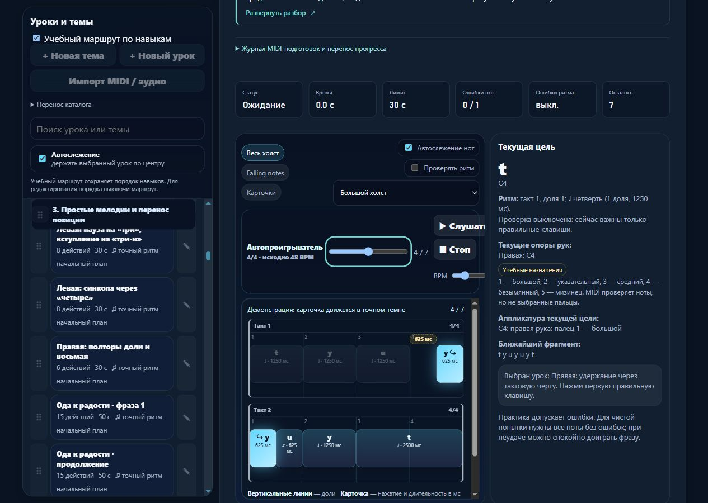

# Курс пианино — партия2026-11-11-04 опубликована

Опубликована и проверена23.5.86,previous85 сохранён. Один новый урок detail-p-barline-hold-right-01: правая D4/2 с «четыре-и» первого такта держится через новое «раз» до «раз-и» одним звуком. C4–D4–E4–D4–E4–D4–C4,пальцы1–2–3–2–3–2–1,48BPM,два такта4/4,семь атак. Это отдельная ритмическая задача на границе тактов,не BPM-вариант.

1305 полных/24 целевых(10новых)/43 Windows service passed;7 Windows-пропусков требуют Linux. Четыре музыкальных аудита прошли.115 выбранных Linux-тестов/7budget прошли без пропусков. Для нового набора115 выбран360s вместо300s по измеренным287.164s у105 предыдущих;384MiB/0.65CPU/network-none/read-only/pids96 прежние,нативные StartLimit не менялись. До renderer-правки реальный тест1fail/8filteredskip;два промежуточных целевых отказа были неверным состоянием pure-VM теста и исправлены в тесте без ослабления runtime. Финальные24/1305 после этого прошли.

Вступления0/1/2/3.5/4.5/5/6,длительности1/1/1/1/.5/1/2,пауза3–3.5,конец8. Подготовки:detail-p-syncopation-hold-right-01 иcourse04-02. Клиентский и серверный оценщики отвергают повторную атаку/отпускание на черте,раннюю следующую ноту,заполненную паузу,неверную высоту/пропуск/короткий финал/keyboard. MIDI-обработчики удерживают D4 и ждут финальное отпускание. Открытый перенос удерживает E4/3 в другой собственной фразе;не новый урок и не независимый слуховой тест. Standard/beat-boundary-v2,схема2 и модели педали/голосов не менялись.

Холст прежде обрезал удержание на черте. Теперь ↪ Продолжение относится к тому же исходному шагу и имеет явное «без нового нажатия»;семь атак не превращаются в восемь. Проверены несколько черт,6/8 в четвертных единицах,окончание на черте,аккорд и память. Расширение отображения одной ноты ограничено64 тактами;повреждённая или более длинная длительность даёт явное ограничение,не меняется и не получает ложную разбивку. Это предел холста,не модели данных/зачёта. Локальный и публичный браузер проверили ноты/счёт/пальцы/источники/обе подготовки с Enter/Space/фокусом,мышь/раскрытие,3вида послеreload,5строк и376px без горизонтального переполнения на390px,поиск/очистку455 записей и сохранённый desktop→390 сценарий148 Произведений. Preview53305/PID58620 остановлен,временная вкладка закрыта,viewport сброшен. MIDI/звук не включались;физическое исполнение/пальцы/качество звука/screen reader/педагог не наблюдались;memory проверен реальным renderer,не гостевой MIDI-попыткой.

Архив melodiajest-23.5.86-20261111-116.tar.gz: c9a3da6d9d5597480546c1d4162925cae9e27fee4db14dfca712b0928923010f, 8590696 B;manifest 532568b2e671f0fbfbb0b06a9d7002494c94d3606e12d691d4f1e136b24d8926;API/source 8e1f0295052281e3feaeac63e872d909b46664cd214c638d8bb77348571fc31e;course 52dd04e09685b53de08ed45fe4c1c07aff99a8886976baa8c7f92cb72922b46c. 1484 source/40 public/1528 files восстановлены локально и выбранным срезом независимо.468runtime/test файлов точные;602 прежние полные записи и454 серверные редакции,темы/порядок/ноты/пальцы/ритм/версии/классификация/grade/XP-контракты/гитарный маршрут/исходныйbaseline сохранены. Поздние финальные документы116 и весь checkout не входят в этот sourcecut;тот же SHA не перепаковывался.

PG snapshot b3ede16169e19aa654d8d1697e86c4876fe6a050e6dcfb409c0a131d48db9672 независимо восстановлен 2026-11-11T11:00:22.960167+00:00;static snapshot 157142e5972e6530e1563379a9a6dab52012973341c69f27bdecd7cc8afffe09 прочитан/расшифрован/восстановлен сcurrent86/previous85 без production-томов. TWO/ONE и неизменные StartLimit4/2h/health8/2h соблюдены;allowance не reservation. Ручные postreader PG/health не объявляются calendar86/daily86. Caddy,таймеры,соседи,14local/F7/workers/kit сохранены. Браузерные личные данные требуют приватного экспорта;полный биллингS3 неизвестен.

Заново прочитаны первичные [The Open University,§3.5,перед примерами20–21 и абзац об одной высоте](https://www.open.edu/openlearn/history-the-arts/music/an-introduction-music-theory/content-section-3.5) и[Open Music Theory,Rhythmic values,Dots and ties](https://open-musictheory.github.io/docs/fundamentals/rhythmic-values/).76 источников,0новых записей/2application. Собственные ноты/пальцы/48BPM/перенос/допуски не приписываются авторам;чужие картинки и фрагменты музыки не копируются. Недоступные страницы не повторялись. Применены существующий find-skills-каталог,свежие Vercel web-design-guidelines и computer-use,без зависимостей/React-переноса.

603каталожных/455учебных/191MIDI/158происхождения/13контролей/10вариантов/432только верхняя граница;verifiedDistinct=null,teacher0. Новых уроков/целей1,контролей/вариантов0;102учебные партии,прежние101 сохранены. Исходная проверка пробела охватила все454 прежних server-ID,включая выведенную классификацию;неполная выборка130 explicit-contentKind исправлена до вывода.4F/6future/2C/voicegap/4manualcards/history20 невнедрённые. Новых paid/resize/mount/защищённых удалений/guitar/commit/push/worktree0.

[Release](../qa/melodiajest-2026-11-11-116-release.json),[public](../qa/melodiajest-2026-11-11-116-public.json),[reader](../qa/melodiajest-2026-11-11-116-reader.json),[browser](../qa/melodiajest-2026-11-11-116-browser.json),[native](../qa/melodiajest-2026-11-11-116-native-postreader.json),[consistency](../qa/melodiajest-2026-11-11-116-consistency.json).

Следующий шаг: Проверить покрытие левого удержания через тактовую черту после detail-p-syncopation-hold-left-01 и detail-p-left-half-01;по первоисточнику реализовать1–2 поддерживаемых микроурока с отдельной задачей левой руки,контрастом с повторной атакой и открытым переносом. Сохранить standard/beat-boundary-v2,ID/ноты/версии/порядок/прогресс. Не дублировать правый урок116 и не считать продолжение на холсте новой атакой. Если потребуется новая модель,сначала отдельные тесты. При начальной лёгкой проверке различать фактическую calendar86-квитанцию и прогноз,не запускать службы ради отчёта;не повторять здоровые тесты/архив86 без изменения или риска.
