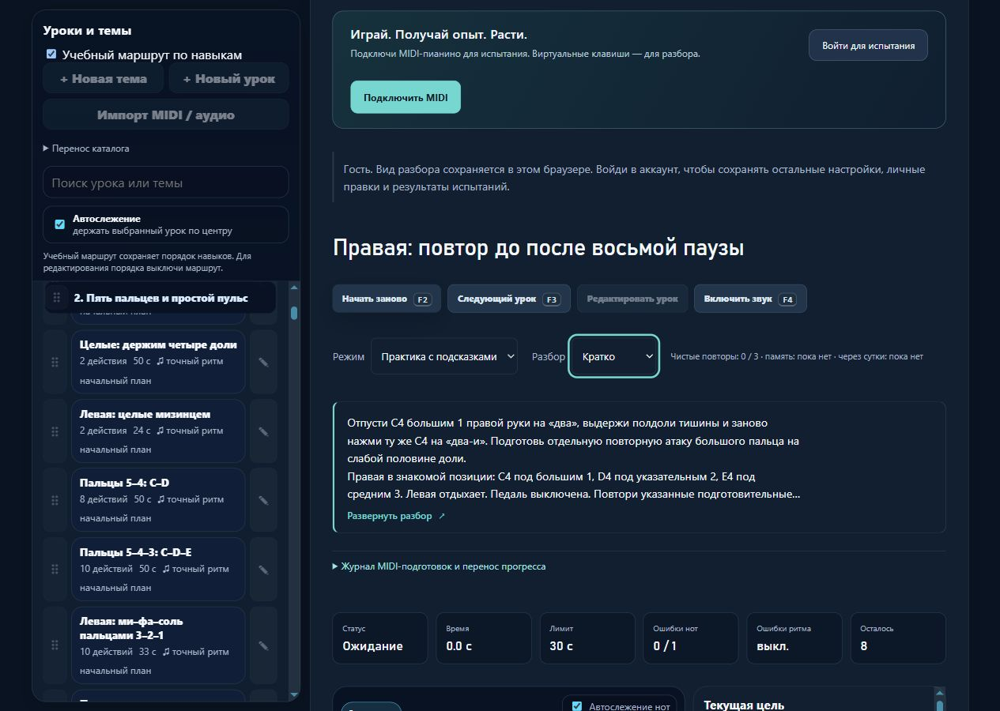

# Курс пианино — партия2026-11-11-06 опубликована

Завершено: 2026-11-11T22:21:14.178552+00:00. Идентификаторы этапа и партии сохраняют дату начала11 ноября.

Опубликована и проверена 23.5.90, previous89 сохранён. Учебная партия2026-11-11-06: два новых коротких технических упражнения проекта на повтор той же высоты после восьмой паузы отдельно каждой рукой. Это две заявленные двигательные задачи, не BPM-варианты; независимая педагогическая проверка ещё не выполнена.

Правая detail-p-eighth-rest-repeat-right-01: C4–C4–D4–E4 дважды, пальцы1–1–2–3. На «два» полностью отпустить C4 большим1, полдоли тишины, новая C4 на «два-и». Вступления0/1.5/2/3/4/5.5/6/7, длительности1/.5/1/1/1/.5/1/1. Подготовки: detail-p-eighth-rest-offbeat-right-01 и detail-p-release-01. Левая detail-p-eighth-rest-repeat-left-01: C3–D3–D3–E3 дважды, пальцы5–4–4–3. На «три» полностью отпустить D3 безымянным4, полдоли тишины, новая D3 на «три-и». Вступления0/1/2.5/3/4/5/6.5/7, длительности1/1/.5/1/1/1/.5/1. Подготовки: detail-p-eighth-rest-offbeat-left-01 и detail-p-release-02. Оба48BPM, два такта4/4, восемь атак, конец8; оба такта заканчиваются ми. Standard/beat-boundary-v2, модели удержанных голосов/педали и оценщики не менялись.

Разбор отличает полудоли тишины и новую атаку от непрерывного удержания/связи. Другая рука отдыхает, педаль выключена, палец рядом с клавишей; при напряжении остановиться. Указаны медленный разбор, счёт, слуховой образец по действию пользователя, ошибки и самопроверка, блок3–5 минут, отдых и возврат на следующий день. Открытый перенос вне зачёта: справа D4–D4–E4–D4/2–2–3–2 с паузой на «два»; слева C3–E3–E3–D3/5–3–3–4 с паузой на «три». Ручная проба переноса не новый урок и не независимый слуховой тест; MIDI не видит пальцы и свободу руки.

Прежние456 canonical server-ID сверены с фактическим каталогом: десять соседних переходов после полудоли тишины в шести уроках, ни одного монофонического повторения той же высоты после этой паузы. Новые задачи поэтому не дублируют прежние повторы. QA gap-before сохранена после реализации реконструкцией всех точных604 прежних записей; это прямо указано, файл не выдаётся за созданный до правки. Нотные данные, пальцы, версии, порядок, темы, классификация, grade/XP-контракты604 прежних записей и456 серверных редакций точны. Все456 прежних строк матрицы, гитарный маршрут и исходный lesson-review-baseline.js сохранены.

Свежие1337 полных /25 музыкальных целевых(8 новых) /5 проверок чтения /43 Windows service /4 музыкальных аудита прошли. Семь Windows-пропусков PostgreSQL-платформы не являются проверенными интеграциями. 152 выбранных Linux-тестов за 496.657s суммарно и7budget прошли. Это147 первоначально прошедших и5 отдельно проверенных reading-кейсов, не единый зелёный152-TAP. Единственный первый отказ MODULE_NOT_FOUND сохранён:1573B build-helper web-app/tools/reading-spec.cjs не входит в архив; его точная копия SHA25a76f9cdd2420ba3fd5017e336d64c9b9ab9b67affc8bedb3b69ebd0826bb52 подключалась отдельным read-only тестовым mount. Производственный код/архив не менялись; здоровые147 не повторялись. Второй reading-only wall60s, фактически16.149s. Linux первый wall540s: прежние139 заняли426.694s, добавлены8 новых и5 затронутых reading-тестов;384MiB/.65CPU/network-none/read-only/cap-drop ALL/pids96 неизменны. Это отдельный выбранный набор, не семь PostgreSQL-интеграций.

До реализации проверка отсутствующих уроков дала0pass/1fail/7filteredskip. Первый новый файл дал7pass/1fail: тест ошибочно запрещал сохранение истории неудачной попытки; уточнён до cleanTakes0/ready!=true/retained!=true при прежнем passed=false. Все плохие MIDI-трассы по-прежнему отвергаются. Первоначальный полный прогон дал1336pass/1fail: исторический счётчик395 совпадений банка чтения вырос до399, два урока добавили четыре совпадения. Все12 кандидатов уже исключались из первого чтения. Тест395 ограничен сохранённым604-кохортом; точное равенство актуального audit и исключение всех12 сохранены. Исторический reading-тест89 скопирован позднее и проверен по119freeze; это не копия до реализации. После правки пять reading и финальные1337 прошли. Старые красные логи сохранены; оценки исполнения и runtime чтения не менялись.

Точные40 браузерных файлов90 без QA-вставки проверены локально и публично: обе новые фразы, ноты/паузы/пальцы в тексте, происхождение/источники/подготовки, правильные следующие ветки, раскрытие мышью/Enter/Space/фокус, три гостевых вида после reload, поиск «повтор» с кареткой6 и458 строк после очистки. На390px кратко112px при line-height22.4px — пять строк, ширина документа376px без горизонтального переполнения. Позиция player3из8 проверена без включения звука. Один offscreen выбор локально не выбрал строку; видимый поиск и кнопка позволили выбрать нужный урок до следующих проверок. Index.html и CSS точно89, здоровая проверка холодного resize119 целиком не повторялась; её доказательства и границы относительной коррекции сохранены. Гостевой memory-челлендж требует входа; отсутствие подсказок в DOM проверено исполняемым renderer во всех трёх видах. MIDI/звук/личные данные/физические пальцы/исполнение/screen reader/педагог не наблюдались. Публичный screenshot API вернул Unable to capture screenshot при обоих методах, видимом браузере и новой вкладке; это ограничение захвата сохранено в QA, успешный публичный визуальный снимок не заявляется. Публичный путь проверен по реальному DOM/AX и измеренному layout; сохранённый desktop-снимок точных40 файлов90 проверен; пустой mobile PNG исключён. Это проверка затронутых путей, не всего сайта. Собственный preview PID7804/51102 остановлен, временная вкладка закрыта, viewport сброшен, публичная вкладка сохранена.

Заново прочитаны первичные [The Open University/OpenLearn, §4.1 перед примером32](https://www.open.edu/openlearn/history-the-arts/music/an-introduction-music-theory/content-section-4.1), [Open Music Theory, Rhythmic values: Rests и Dots and ties](https://open-musictheory.github.io/docs/fundamentals/rhythmic-values/), [Jerry Kovarsky/Yamaha, The Basics и Scenario One, 28.11.2023](https://hub.yamaha.com/keyboards/k-how-to/the-basics-of-piano-keyboard-fingering/). Они поддерживают длительность тишины, отличие связи одинаковых высот от новой атаки, нумерацию и подготовленный выбор пальцев. Собственные ноты, конкретные повторы, пальцы,48BPM, перенос и допуски — решения проекта, не методика, одобренная авторами. Чужие нотные изображения и произведения не копировались; исторические утверждения не добавлялись. 76 записей источников сохранены,0 новых записей/3 новые applications;104 завершённые учебные партии, прежние103 точны. Find-skills-каталог и [свежие Vercel Web Interface Guidelines](https://raw.githubusercontent.com/vercel-labs/web-interface-guidelines/main/command.md) использованы для затронутого пути; computer-use проверил браузер. Новых зависимостей/плагинов/React-переноса0.

Архив melodiajest-23.5.90-20261111-120.tar.gz: 579a7391c635382064dc5db6385867ef7f6a32c45e20974ce8a9acd8ab6a24bb, 8887118 B; manifest 32f595309c0d5a08957fa7a3598a8a175a92214d2d1c7e7c06184025859e0364; API/source 6b103408ba0e87079ea0fd4ad8e56ff0f48ad5562192ae010eaa06e68cca51c0; course 0ed7c9b65c3c255a2ab1bc4763a4c70daed4e2efc53b4da77a93ce797baa0a8d. 1540 source /40 public /1584 files восстановлены локально и выбранным срезом независимо.474 runtime/test файлов точные. Поздние финальные документы120 и весь checkout не входят в этот sourcecut; тот же SHA не перепаковывался.

PG snapshot 243d0be611e16fb1d323917c3f4381dcea00ee8ee1edd0899583fe13a332b5bd независимо прочитан/расшифрован/восстановлен 2026-11-11T22:13:49.633212+00:00; static snapshot 0f00e178915151be1d684217eb29ce9063ab1301650262da4d9047de1e41271f восстановлен сcurrent90/previous89 без production-томов. TWO/ONE и неизменные StartLimit4/2h/health8/2h соблюдены; allowance не reservation. Postreader90 PG восстановлен штатным15min автоматическим повтором после отказа общей блокировки21:58; немедленный возврат API тоже был lock-blocked, его не форсировали. API90/static89 оставались доступны, совместимость456 редакций проверена; миграции/production restore/rollback/reset/ослабления лимитов не выполнялись. Статика90 опубликована после успешной независимой PG90-копии. Health90 затем вызван вручную. Обе успешные квитанции сверены с журналами; это не calendar90/daily90. Исходный отказ сохранён в QA120-native-lock-failure.json и U.nativeRecovery. Следующие календарные времена — прогноз, не доказательство запуска. Caddy, таймеры, соседи Libreta/Praicer/Grigorova,14local/F7/workers/kit/source59 сохранены. Браузерные личные данные требуют приватного экспорта; полный биллингS3 неизвестен.

606 каталожных /458 учебных /194 MIDI /161 с происхождением /13 контролей /10 вариантов /435 только верхняя граница; verifiedDistinct=null, teacher0. Новых учебных записей2, заявленных самостоятельных задач2, контролей/вариантов0. 4F/6future/2C/voicegap/4manualcards/history20 остаются невнедрёнными. Нет guitar/commit/push/worktree/paid/resize тарифа/mount/защищённых удалений.

[Release](../qa/melodiajest-2026-11-11-120-release.json), [public](../qa/melodiajest-2026-11-11-120-public.json), [reader](../qa/melodiajest-2026-11-11-120-reader.json), [browser](../qa/melodiajest-2026-11-11-120-browser.json), [gap](../qa/melodiajest-2026-11-11-120-gap-before.json), [Linux](../qa/melodiajest-2026-11-11-120-linux.json), [native](../qa/melodiajest-2026-11-11-120-native-postreader.json), [consistency](../qa/melodiajest-2026-11-11-120-consistency.json).

Следующий шаг: Проверить покрытие повторного нажатия одной высоты со сменой пальца после восьмой паузы отдельно по рукам. Сопоставить фактические ноты, ритм, аппликатуру и подготовку с существующими повторами; не объявлять пробел заранее. При подтверждённом пробеле по первоисточнику реализовать 1–2 коротких поддерживаемых задания с тишиной, новой атакой и открытым переносом; иначе выбрать следующий подтверждённый двигательный пробел. Сохранить ID, прежние версии и прогресс, standard/beat-boundary-v2. Nativequota заново; PG4/2h и health8/2h без обхода; не повторять здоровые проверки и архив90 без изменения или нового риска.

Независимое чтение сохранённых PNG в конце этапа: desktop-снимок точной90 сборки содержит действительную карточку правой руки и принят; mobile PNG содержит только фон, исключён и оставлен как отклонённое доказательство. После этого capture API также недоступен в новой видимой локальной вкладке. Мобильные размеры подтверждены DOM/layout; сохранённый публичный или мобильный визуальный снимок не заявляется. Дополнительный read-only preview PID18992/65155 остановлен; исходный7804/51102 также остановлен. Артефакт не перепаковывался.
