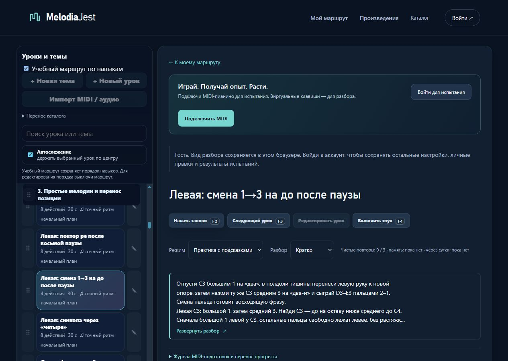

# Курс пианино — партия2026-11-11-07 опубликована

Завершено: 2026-11-12T00:09:29.971023+00:00. Этап121 и партия2026-11-11-07 сохраняют дату начала11 ноября; окончание пришлось на12 ноябряUTC.

23.5.91 опубликована и проверена. Предыдущая23.5.90 сохранена. Добавлен один технический микроурок проекта «Левая: смена1→3 на до после паузы» (`detail-p-eighth-rest-thumb-middle-left-01`). Это одна заявленная двигательная задача; независимая педагогическая проверка ещё не выполнена.

Левая рука играет C3–C3–D3–E3 пальцами1–3–2–1. На «два» большой1 полностью отпускает C3. Во время полудоли тишины вся рука немного смещается вправо; на «два-и» средний3 заново нажимает ту же C3, затем следуют D3/2 и E3/1. Так смена опоры готовит восходящую тройку3–2–1. Не нужны растяжка, высокий подъём пальца или подмена пальца на удержанном звуке.

Один такт4/4 при48BPM: вступления0/1.5/2/3, длительности1/.5/1/1, пауза1–1.5, полное последнее отпускание у4. Подготовки — `detail-p-eighth-rest-repeat-left-01` и `detail-p-left-upper-position-01`; следующий урок — `detail-p-syncopation-hold-left-01`. Открытый перенос D3–D3–E3–F3/1–3–2–1 остаётся ручной пробой вне MIDI-зачёта. Он не считается ещё одним уроком или независимым тестом слуха. В разборе сохранены счёт, слуховой ориентир, ошибки, самопроверка, блок3–5 минут, отдых и возврат на следующий день.

До правки проверены458 старых canonicalID и1094 соседних монофонических перехода одной высоты. Четыре перехода после восьмой паузы использовали тот же палец; девять явных смен пальца в пяти уроках не содержали левого1→3. Старый левый повтор5–4–3–5 с артикуляционным разрывом0.35 доли не выдаётся за основание добавить лишь другую длительность паузы. Выбранная задача меняет опору руки для следующего восходящего движения. Правый аналог в эту партию не добавлялся.

Сохранены606 прежних полных записей и458 серверных редакций, их ноты, пальцы, ритм, версии, порядок, темы, классификация и grade/XP-контракты. Схема2, standard/beat-boundary-v2, оценщики, index/CSS, гитарный маршрут и исходный lesson-review-baseline.js не менялись. Все104 прежние учебные партии и76 прежних записей источников с их applications точны.

Проверки выполнены на исполняемом коде приложения:

- `npm test`:1345 прошли, без отказов и пропусков.
- Целевой набор:29 прошли, включая8 новых и5 проверок чтения. Эти5 уже входят в29.
- Windows service:43 прошли;7 пропусков PostgreSQL по платформе не объявляются интеграционными проверками.
- Четыре свежих музыкальных аудита прошли. `audit:fingering` охватывает прежние1036 нот, а не все607 записей; четыре новые ноты отдельно проверены новым исполняемым тестом.
- Linux:155 основных за519851.795916ms и5 проверок чтения за15607.967359ms; оба заранее объявленных первых прогона без отказов и пропусков. Это два набора, а не один160TAP. Ограничения384MiB/.65CPU/network-none/read-only/cap-dropALL/pids96 сохранены; wall600s и60s. Все входы получены из точного архива91, включая helper1573B, восстановленный из архивного QAJSON с проверкой SHA. Здоровые155+5 повторно не запускались.
- Семь проверок модуля бюджета запусков прошли. TWO/ONE наблюдались заново перед соответствующими действиями; это не резервирование запусков.

Первые красные логи, ошибка генератора short-final trace и корректировка исторической606/458cohort сохранены ниже. Музыкальные контракты и оценщики не ослаблялись. Отдельная ошибка метаданных упаковки после успешного архива исправлена по уже восстановленным файлам: тот же архив не перепаковывался и повторное полное восстановление ради неё не выполнялось.

Точные40 браузерных файлов локально и публичная91 проверены через CUA DOM/AX: C3/1→C3/3 через виртуальную клавишу в практике, обе подготовки, следующая левая ветка, Enter/Space/фокус, три гостевых вида после reload, поиск1→3/каретка3/очистка459 строк, player2из4 и desktop→390→desktop. При390px краткий разбор занимает пять строк112px/22.4px, ширина документа376px без переполнения. Память без подсказок дополнительно проверена исполняемым renderer-тестом.

Локальный capture91 не работал. Единственная последующая попытка публичного снимка удалась: исходный JPEG1265×900/118098B независимо открыт и просмотрен. Видны новый заголовок, выбранная строка и краткий разбор. Исправлено только расширение по фактическому формату; пиксели не менялись. Сохранённого мобильного снимка91 нет. Preview16292/64067 остановлен, временная вкладка закрыта, viewport сброшен, публичная вкладка сохранена. Реальные MIDI/звук, физические пальцы, исполнение, screen reader, педагог и весь сайт не наблюдались.

Первоисточники прочитаны заново: [Robert Estrin/Pianist — быстрые и медленные повторы](https://www.pianistmagazine.com/how-to-play-repeated-notes-on-the-piano), [Jerry Kovarsky/Yamaha — TheBasics и ScenarioThree](https://hub.yamaha.com/keyboards/k-how-to/the-basics-of-piano-keyboard-fingering/), [OpenMusicTheory — Rests и Dotsandties](https://open-musictheory.github.io/docs/fundamentals/rhythmic-values/). Их общие принципы отделены от наших C3/1–3–2–1, полудоли тишины,48BPM и числовых допусков. Нотные примеры источников не копировались. Авторское одобрение, известный ученик и историческая связь не заявлены. В журнале77 источников: одна новая запись и три applications одной партии07; всего105 завершённых учебных партий. Применены find-skills-каталог, свежие web-design-guidelines и computer-use; новых зависимостей, плагинов и React-переноса нет.

Архив `melodiajest-23.5.91-20261111-121.tar.gz` имеет9023958B и SHA256 `527d6bf8804fdf6489eef84c18fb2f4c5328c83caeb31cab5e3f6358c56e23dc`. Manifest:`c01562c346e1935af0bc9fb9952ecc5c39850c3fd1f7888b5a01262c4d0cb50b`; API/source:`b07aa82770cd5e0548298481594b7309462b1d86e0a0062b93850e280f4cf864`; course:`8c02d2b57fe3e5828c77d5981b9cdc60df641d3c53350968d6278b977d611c09`. Локально восстановлены1559 source /40 public /1603 файла;476 runtime/test файлов сверены по хешам. Независимый серверный срез восстановлен отдельно. Поздние финальные документы121, этот снимок и весь текущий checkout не входят в immutable sourcecut; тот же SHA не перепаковывался.

Перед сменой читателя свежим сравнением данных подтверждён прежний снимок90; повторная полная копия того же хеша не объявляется новой. PostgreSQL91 `d18fe245616c6d46df6605dcf75b813b82076122cb224cbc51581aaf67dc3e06` независимо прочитан, расшифрован и восстановлен `2026-11-11T23:59:43.456333+00:00`. Static snapshot `62ab929439a715399693b350d676aab6c16410ce3e16edae92232052ffa531a5` независимо восстановлен с current91/previous90 без production-томов. Рабочие данные из копии не заменялись, миграции не выполнялись.

С23:09 до23:57 TWO оставался false: ожидали без лишних starts/reset/force/stop. После свежего TWO выполнены штатная защита данных и isolated reader91, затем свежий ONE и обычные API/static updater. PG4/2h, health8/2h и15min backoff не менялись. HTTPS, публичные хеши40 файлов, редиректы, закрытые служебные пути, уникальные aliases и соседи проверены. Caddy, таймеры,14local/F7/workers/kit/source59 сохранены.

Календарный health91 в00:01:07 действительно запускался, но получил TEMPFAIL75/deferred `operation-lock-busy`. Базовая часть прошла; отложенная внешняя часть не является полной успешной квитанцией. Владелец блокировки не установлен. Запланированный шаг ручного postrelease-health в00:01:13 затем успешно сверил обе полные квитанции. Оба invocation сохранены отдельно. Этот ручной успех не объявляется calendar-success91 или dailyPG91; прежний прямой calendar90 в23:01 сохранён как90. Следующее время таймера — прогноз. Проверяющие readers новых служб не запускали. Личные данные браузера требуют приватного экспорта; полный биллингS3 неизвестен.

Текущий каталог:607 записей /459 учебных /195 MIDI /162 с происхождением /13 контролей /10 вариантов.436 — только верхняя граница числа самостоятельных целей; `verifiedDistinct=null`, teacher0.4F/6future/2C/voicegap/4manualcards/history20 остаются невнедрёнными. Guitar, commit/push, worktree, платные услуги, тариф, DNS, mounts и защищённые удаления не затрагивались.

Доказательства: [release](../qa/melodiajest-2026-11-11-121-release.json), [public](../qa/melodiajest-2026-11-11-121-public.json), [reader](../qa/melodiajest-2026-11-11-121-reader.json), [browser](../qa/melodiajest-2026-11-11-121-browser.json), [Linux](../qa/melodiajest-2026-11-11-121-linux.json), [native](../qa/melodiajest-2026-11-11-121-native-postreader.json), [calendar deferred](../qa/melodiajest-2026-11-11-121-calendar91-deferred.json), [image](../qa/melodiajest-2026-11-11-121-image-proof.json), [consistency](../qa/melodiajest-2026-11-11-121-consistency.json).

Следующий шаг: Разобрать сохранённые lock-refusal120 при postreader PG и calendar-health121 deferred: подготовить узкую изолированную проверку точки возобновления и честного статуса отложенной проверки без новых production-запусков. Сохранить PG4/2h,health8/2h,15min backoff и общую блокировку;не force/reset/stop. Затем вернуться к подтверждённому двигательному пробелу курса. Nativequota и лёгкая HTTPS/версия/свежесть известных квитанций;не повторять здоровые1345/29/43/4аудита/155+5Linux и архив91 без нового риска.

## Сохранённый ход подготовки и ограничения

# Учебная партия2026-11-11-07 — левая смена опоры1→3

Один технический микроурок реализован локально в кандидате23.5.91; public23.5.90/previous89 не менялись. Локальные проверки завершены; отдельная публикация ещё ожидается.

Левая detail-p-eighth-rest-thumb-middle-left-01: C3–C3–D3–E3/1–3–2–1, один такт4/4/48BPM. Вступления0/1.5/2/3, длительности1/.5/1/1; пауза1–1.5, конец4. На «два» полностью отпустить большой1, в полдоли тишины сместить всю руку к C3/3–D3/2–E3/1. Новая C3 на «два-и» средним3. Начальная C3/1 указана явно, не привычным левым5. Подготовки: detail-p-eighth-rest-repeat-left-01 и detail-p-left-upper-position-01. Открытый перенос D3–D3–E3–F3/1–3–2–1 вне зачёта; не новый урок/слуховой тест.

Проверены458 canonicalID с действительным stored timing:1094 монофонических соседних повторения одной высоты,4 перехода после полудоли тишины без смены пальца;9 явных смен пальцев в5уроках, включая старые1–2–3–1 справа и5–4–3–5 слева с0.35доли зазора. Их общая цель повтора уже покрыта, новый урок не создаётся лишь заменой0.35на0.5. Точной левой1→3 на одной высоте и следующей восходящей3–2–1 фразы в этом срезе нет. Выбрана только эта конкретная двигательная задача; весь курс не объявляется проверенным педагогически. QA121-finger-change-coverage.json создан до реализации.

Заново прочитаны [Robert Estrin/Pianist,разделы о быстрых и медленных повторах](https://www.pianistmagazine.com/how-to-play-repeated-notes-on-the-piano), [Jerry Kovarsky/Yamaha,The Basics и Scenario Three](https://hub.yamaha.com/keyboards/k-how-to/the-basics-of-piano-keyboard-fingering/), [Open Music Theory,Rests/Dots and ties](https://open-musictheory.github.io/docs/fundamentals/rhythmic-values/). Они поддерживают различие контекстов повторов, предварительный выбор пальцев/позиции и длительность тишины. Проектные1–3–2–1/полудоля/48BPM/перенос/допуски не приписываются авторам. Подъём пальца высоко, универсальная обязанность менять пальцы, обещание быстрых репетиций, чужая партитура и история знаменитого исполнителя не добавлены.77источников:1новая записьEstrin,3новые applications; прежние76 сохраняются.

Новый тест до реализации0pass/1fail/7filteredskip. Исходные606 полных записей,458 серверных редакций, темы/порядок/пальцы/grade/XP/гитарный маршрут/исходныйbaseline сохранены в новом prechange-отпечатке. Standard/beat-boundary-v2 и все модели/оценщики прежние. Реальное MIDI/пальцы/звук/педагог не наблюдались.

Локальные проверки завершены:1345 полных без пропусков,29 целевых(8новых и5reading),43service/7Windows platform skips,4аудита. Fingering audit имеет свой прежний ограниченный корпус1036нот; конкретные4ноты нового урока и пальцы1–3–2–1 проверены отдельными исполняемыми регрессиями, не педагогом. Полный root496628.6856ms, target25116.8842ms, service25029.7128ms.

Первый новый файл7pass/1fail: short-final trace ошибочно проверял i==7 при4нотном уроке и не менял финал. Исправлен генератор до last index, добавлена проверка, что каждый плохой trace действительно отличается от clean. Клиент/сервер отвергают короткий финал; runtime не менялся. Первый combined27pass/2fail: старые глобальные счётчики120606/458; привязаны к историческому606cohort и актуальному общему fixture. Прежние604/456хеши и нотные/ритмические/пальцевые/плохие MIDI/DOM проверки сохранены. Оригинальный120тест скопирован позднее и совпал с120freeze; не назван копией до реализации. Финальные29/1345 после правки зелёные, красные логи сохранены.

Локальный CUA DOM/AX точных40файлов91: первая C3/палец1, после виртуального нажатия повторC3/палец3 и пауза625ms; обе подготовки/следующая левая синкопа,Enter/Space/фокус,3гостевых вида послеreload,поиск1→3/каретка3/459послеочистки,player2из4,1280→390→1280. На390px112px/22.4px/пятьстрок иdocument376px без горизонтального overflow измерены поDOM. CaptureAPI остаётся недоступен дажеcombinedAX+screenshot; новый сохранённый снимок91 не заявляется, мобильный PNG120 по-прежнему исключён. Preview16292/64067 остановлен, временная вкладка закрыта,viewport сброшен,публичная90 вкладка сохранена.

Штатный TWO-бюджет22:53UTC не разрешал два PG-start:3старта в2h. notBefore23:57:08UTC — прогноз, не reservation/запуск. До свежего разрешения толькоimmutable staging/Linux; API/статика90,его архив и рабочие данные не меняются,PG/health limits не reset/повышаются.

После единственной упаковки assertion ошибочно искал QA JSON в меньшем API runtime subset. Файл проверен по SHA в уже восстановленном полном source archive; завершена только запись checkpoint, без повторной упаковки/восстановления. Отдельный pack-log не создавался; исходный отказ сохранён в tool output этого чата и QA121-pack-metadata-recovery.json.

Linux завершён:155main за519851.795916ms и5reading за15607.967359ms, суммарно535459.763275ms, оба прогона без отказов/пропусков. Это два заранее объявленных набора, не единый160TAP. Оба используют точный91-архив; единственный generated readonlyhelper получен из его QA120-reading-support.json с проверкой1573B/SHA, внешних тестовых входов нет.7budget прошли;TWO после них всё ещёfalse. API/static90 и рабочие данные прежние,preUpdateSnapshot=null;изменялись толькоownstaging/testcontainers. До23:57:08UTC и заново allowedTWO нельзя готовить reader/выкладку.155+5кэшированы поSHA — повтор не нужен.

Отдельно только чтением подтверждён настоящий прямойhourly90:23:01:40.844903–23:01:41.461000UTC,timer/service/invocation/journal/обе полные квитанции точные,S3requests0/restorefalse/своихstarts0. Это успешныйcalendar90,неdailyPG90 и неcalendar91. Прежнийmanual90 и отказ/autoPG15min120 сохранены в истории.

Текущий результат:607local/459learning/195MIDI/162provenance/436upper;на сайте90 остаются606/458/194/161/435.77sources/3new applications,104completed musical batches;105 не добавлен до публикации. Candidate91архив527d6bf8804fdf6489eef84c18fb2f4c5328c83caeb31cab5e3f6358c56e23dc/9023958B/1559source40public1603restored,476runtime frozen. Новая independentS3/reader91/publicDOM91 ещё не проверены;последние проверенные копии относятся90. Поздние финальные документы121 и wholecheckout вне immutable sourcecut;архив не перепаковывался.

Следующий шаг: Продолжить этот же121 и готовый91 после23:57:08UTC только при заново проверенном allowedTWO. Nativequota→сверить476runtime/тотже527dархив→fresh preflight→prepare-publication-121-server.py БЕЗ --stage-only(переиспользует155+5 поSHA,не повторять)→актуальная штатная копия90/isolated reader91→freshONE→publish-publication-121.py→публичные хеши/HTTPS/новый путьDOM→native-postreader/independentPG-staticrestore→финальные курсоры/тажеавтоматизация. ЕслиTWOfalse/PGactive/backoff — ждать без start/reset/stop/обхода. Новыеуроки/источники не добавлять до завершения выпуска91.
